# Produktbild-Kandidaten — interner Review

> Technische Recherche, keine Veröffentlichungsfreigabe. Nur Bilder mit
> einer expliziten redaktionellen Entscheidung dürfen später nach
> `public/brand/screenshots/<slug>/shot-N.jpg` übernommen werden.

- Tools geprüft: 59
- Tools mit Kandidaten: 33
- heruntergeladene Kandidaten: 104

## Eye-Able (Web Inclusion GmbH)

### Kandidat 1 — Score 32

- Bildquelle: https://a2.storyblok.com/f/259811/2156x1144/37879bf91c/dashboard_en.png/m/1920x0/filters:quality(70):no_upscale()
- Fundstelle: https://eye-able.com
- Format: 1920 × 1019 px · webp
- Gründe: +12:dashboard, +6:grosse-quelldatei, +8:hohe-aufloesung, +6:produktbild-format
- Review: `needs_review` — zeigt das Bild wirklich die Software-Oberfläche?

## Facelift Cloud GmbH

### Kandidat 1 — Score 19

- Bildquelle: https://facelift-bbt.com/hs-fs/hubfs/Product_Amplify.png?width=1492&height=1085&name=Product_Amplify.png
- Fundstelle: https://facelift-bbt.com
- Format: 1492 × 974 px · webp
- Gründe: +5:product, +8:hohe-aufloesung, +6:produktbild-format
- Review: `needs_review` — zeigt das Bild wirklich die Software-Oberfläche?

### Kandidat 2 — Score 19

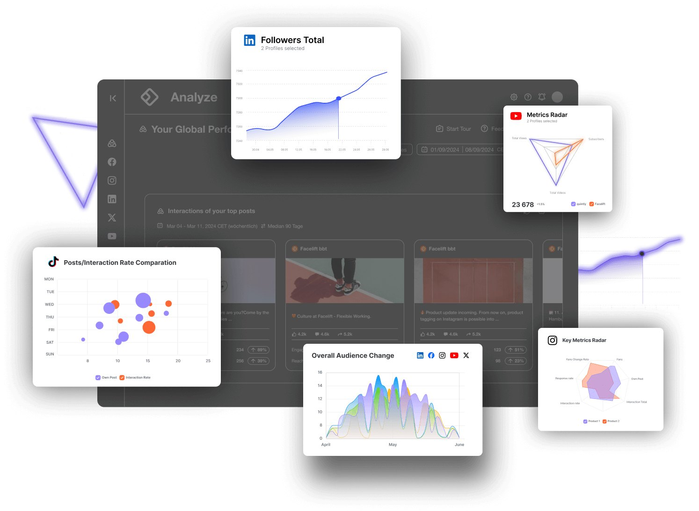

- Bildquelle: https://facelift-bbt.com/hs-fs/hubfs/Product_Analyze.png?width=1494&height=1094&name=Product_Analyze.png
- Fundstelle: https://facelift-bbt.com
- Format: 1494 × 1094 px · webp
- Gründe: +5:product, +8:hohe-aufloesung, +6:produktbild-format
- Review: `needs_review` — zeigt das Bild wirklich die Software-Oberfläche?

### Kandidat 3 — Score 19

- Bildquelle: https://facelift-bbt.com/hs-fs/hubfs/Product_Engage.png?width=1538&height=1052&name=Product_Engage.png
- Fundstelle: https://facelift-bbt.com
- Format: 1538 × 1052 px · webp
- Gründe: +5:product, +8:hohe-aufloesung, +6:produktbild-format
- Review: `needs_review` — zeigt das Bild wirklich die Software-Oberfläche?

### Kandidat 4 — Score 19

- Bildquelle: https://facelift-bbt.com/hs-fs/hubfs/Product_Orchestrate.png?width=1506&height=1064&name=Product_Orchestrate.png
- Fundstelle: https://facelift-bbt.com
- Format: 1506 × 1041 px · webp
- Gründe: +5:product, +8:hohe-aufloesung, +6:produktbild-format
- Review: `needs_review` — zeigt das Bild wirklich die Software-Oberfläche?

### Kandidat 5 — Score 14

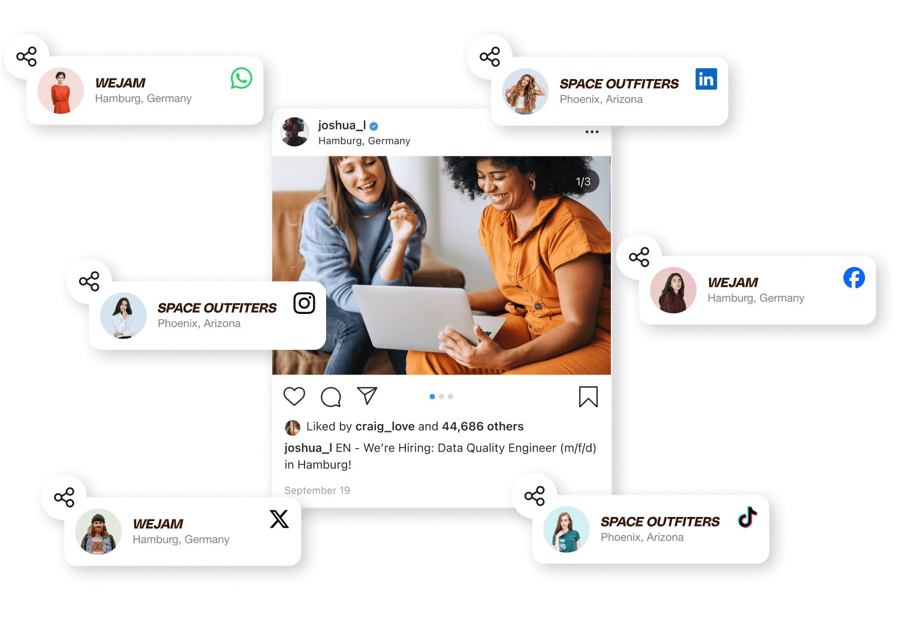

- Bildquelle: https://facelift-bbt.com/hs-fs/hubfs/Amplify_Branch_Network_Locations.png?width=1498&height=1040&name=Amplify_Branch_Network_Locations.png
- Fundstelle: https://facelift-bbt.com
- Format: 1498 × 1040 px · webp
- Gründe: +8:hohe-aufloesung, +6:produktbild-format
- Review: `needs_review` — zeigt das Bild wirklich die Software-Oberfläche?

## SocialHub (maloon GmbH)

Keine ausreichend großen Bildkandidaten gefunden.

## Stage (Stagelink / Staffbase-Familie)

### Kandidat 1 — Score 25

- Bildquelle: https://staffbase.com/f/e02207339dd64d27/1328x1328-homepage-intranet-de-2025-09-15v2.webp
- Fundstelle: https://staffbase.com/de
- Format: 1328 × 840 px · webp
- Gründe: +5:screen, +6:grosse-quelldatei, +8:hohe-aufloesung, +6:produktbild-format
- Review: `needs_review` — zeigt das Bild wirklich die Software-Oberfläche?

### Kandidat 2 — Score 25

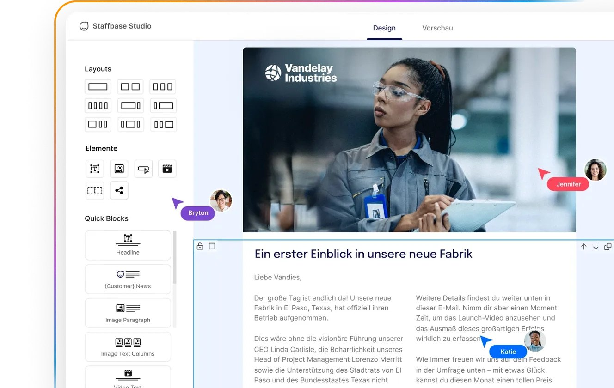

- Bildquelle: https://staffbase.com/f/e9857f702842fe08/1328x1328-homepage-email-de-2025-09-15v2.webp
- Fundstelle: https://staffbase.com/de
- Format: 1328 × 840 px · webp
- Gründe: +5:screen, +6:grosse-quelldatei, +8:hohe-aufloesung, +6:produktbild-format
- Review: `needs_review` — zeigt das Bild wirklich die Software-Oberfläche?

### Kandidat 3 — Score 25

- Bildquelle: https://staffbase.com/f/f162dbbeca7bfbd9/1328x1328-app_de_2025_09_24.webp
- Fundstelle: https://staffbase.com/de
- Format: 1328 × 837 px · webp
- Gründe: +5:app, +6:grosse-quelldatei, +8:hohe-aufloesung, +6:produktbild-format
- Review: `needs_review` — zeigt das Bild wirklich die Software-Oberfläche?

### Kandidat 4 — Score 16

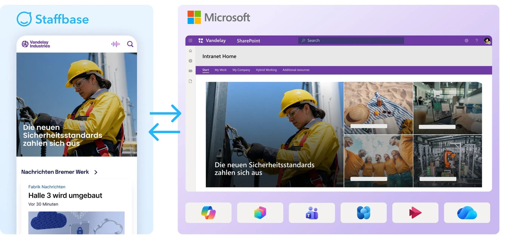

- Bildquelle: https://staffbase.com/f/ab480fead4bb1fe8/2736x1539-shared-news-de.webp
- Fundstelle: https://staffbase.com/de
- Format: 2736 × 1268 px · webp
- Gründe: +5:app, -9:team, +6:grosse-quelldatei, +8:hohe-aufloesung, +6:produktbild-format
- Review: `needs_review` — zeigt das Bild wirklich die Software-Oberfläche?

### Kandidat 5 — Score 9

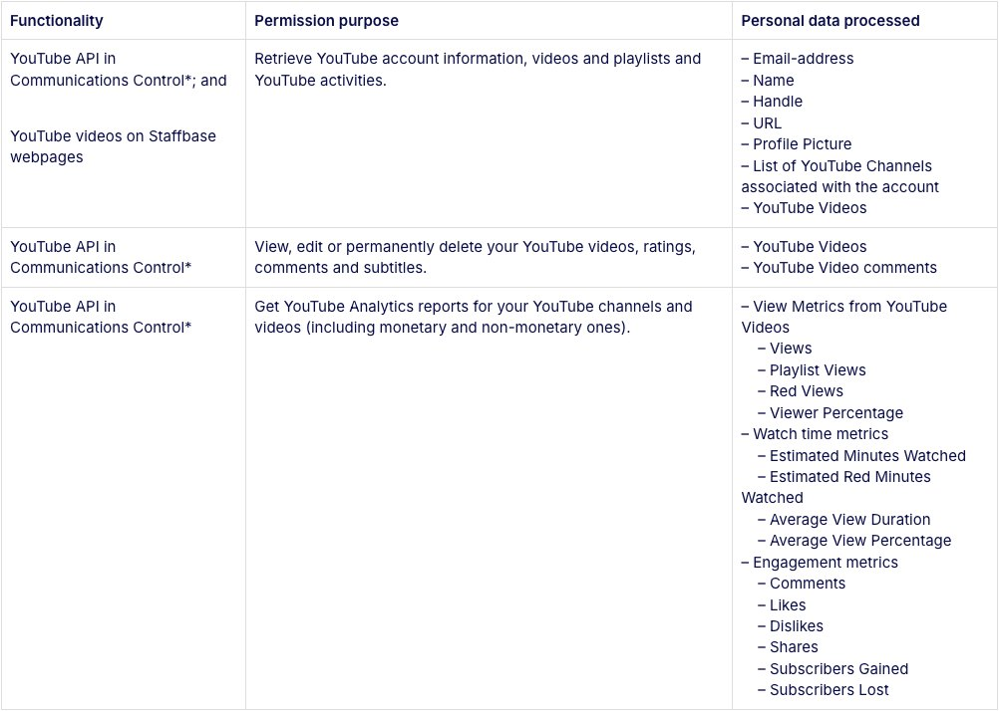

- Bildquelle: https://staffbase.com/f/37e82a2ec0498aa9/1003x715-youtube-personal-data-collected.png
- Fundstelle: https://staffbase.com/de/legal/privacy-policy-youtube-api
- Format: 1003 × 715 px · png
- Gründe: -8:person, +6:grosse-quelldatei, +5:brauchbare-aufloesung, +6:produktbild-format
- Review: `needs_review` — zeigt das Bild wirklich die Software-Oberfläche?

## Haiilo GmbH

### Kandidat 1 — Score 19

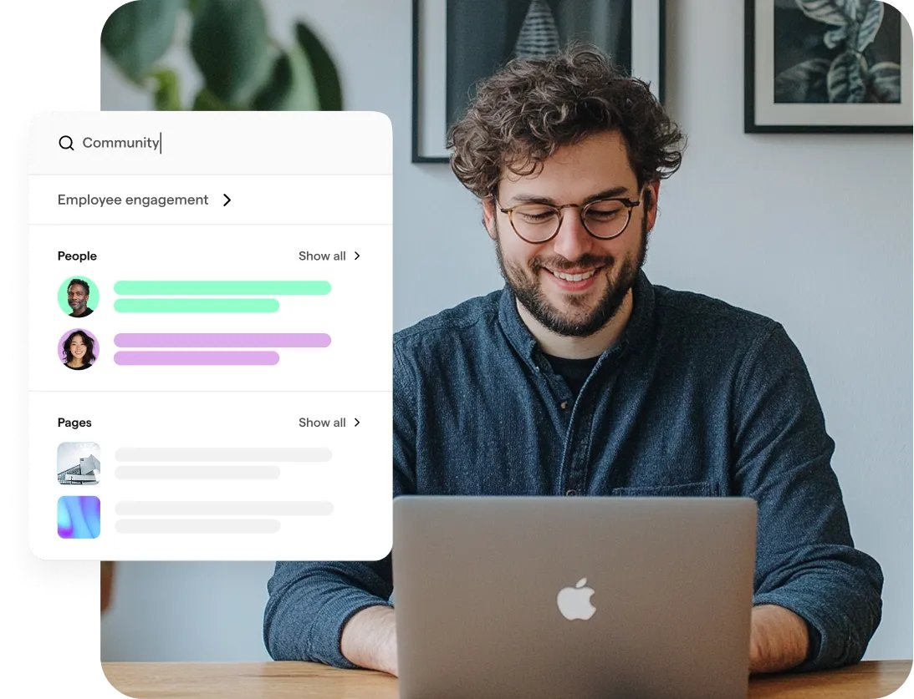

- Bildquelle: https://cdn.prod.website-files.com/698dce64b0fee67aeca65f51/69a1c92145412ec5cd999a0a_advocacy%20image.webp
- Fundstelle: https://haiilo.com
- Format: 1093 × 837 px · webp
- Gründe: +8:interface, +5:brauchbare-aufloesung, +6:produktbild-format
- Review: `needs_review` — zeigt das Bild wirklich die Software-Oberfläche?

### Kandidat 2 — Score 12

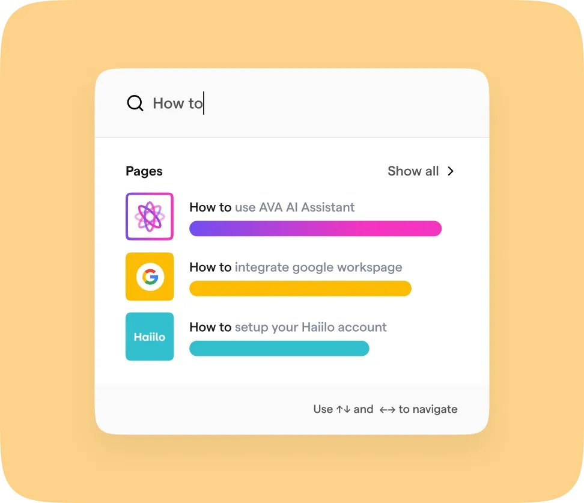

- Bildquelle: https://cdn.prod.website-files.com/698dce64b0fee67aeca65f51/69b3d94238517e8a8341581a_7335d9f66308a02b083ac0d6897f42f6_Search%20Container.webp
- Fundstelle: https://haiilo.com
- Format: 972 × 837 px · webp
- Gründe: +7:workspace, +5:brauchbare-aufloesung
- Review: `needs_review` — zeigt das Bild wirklich die Software-Oberfläche?

### Kandidat 3 — Score 17

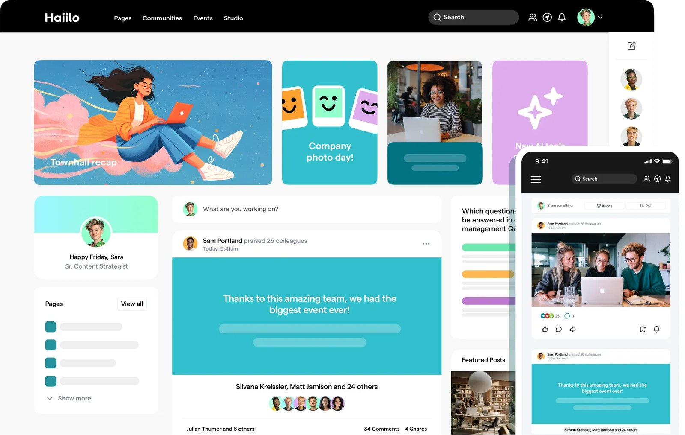

- Bildquelle: https://cdn.prod.website-files.com/698dce64b0fee67aeca65f51/69a1be045eed21fc6f54087c_haiilo%20dashboard.webp
- Fundstelle: https://haiilo.com
- Format: 1877 × 1195 px · webp
- Gründe: +12:dashboard, -9:team, +8:hohe-aufloesung, +6:produktbild-format
- Review: `needs_review` — zeigt das Bild wirklich die Software-Oberfläche?

### Kandidat 4 — Score 14

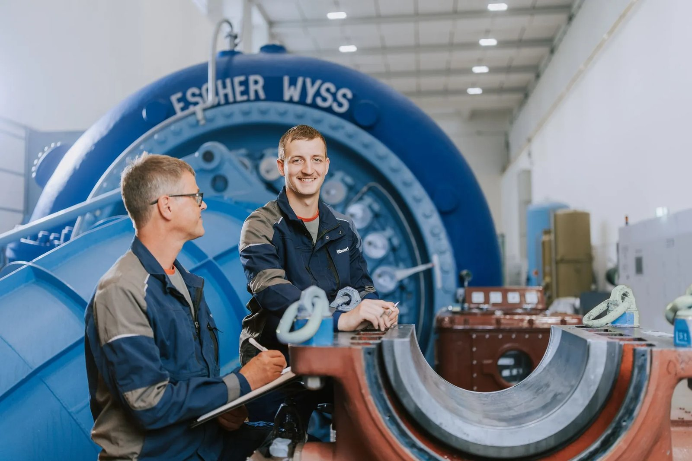

- Bildquelle: https://cdn.prod.website-files.com/698df1ed7556a9989a305556/6a13200e0a3a73d9d6346217_illwerke%2Bvkw_Pressebild%2BMonteur%2BWasserkraft-1920w.webp
- Fundstelle: https://haiilo.com
- Format: 1920 × 1280 px · webp
- Gründe: +8:hohe-aufloesung, +6:produktbild-format
- Review: `needs_review` — zeigt das Bild wirklich die Software-Oberfläche?

### Kandidat 5 — Score 14

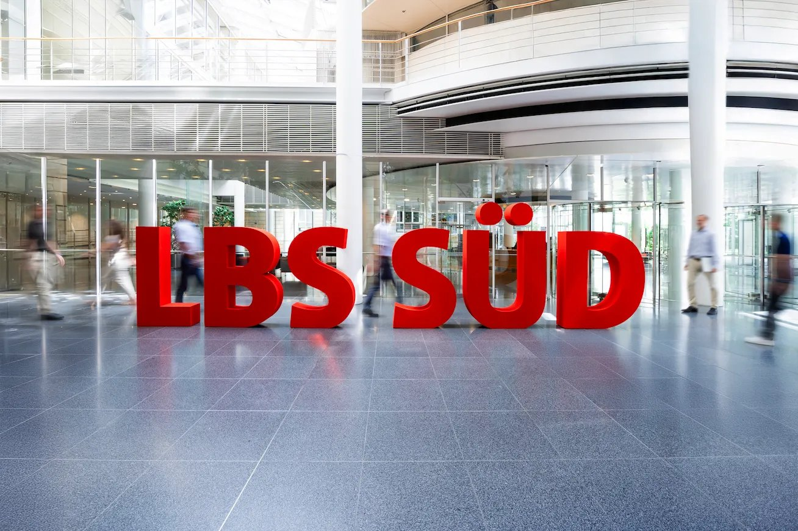

- Bildquelle: https://cdn.prod.website-files.com/698df1ed7556a9989a305556/6a1320d6bb084731fef4f835_LBS%2BSu-d-1920w.webp
- Fundstelle: https://haiilo.com
- Format: 1308 × 872 px · webp
- Gründe: +8:hohe-aufloesung, +6:produktbild-format
- Review: `needs_review` — zeigt das Bild wirklich die Software-Oberfläche?

## IP Dynamics GmbH

Keine ausreichend großen Bildkandidaten gefunden.

## Parloa GmbH

Keine ausreichend großen Bildkandidaten gefunden.

## Scompler GmbH

Keine ausreichend großen Bildkandidaten gefunden.

## Swat.io (Die Socialisten GmbH)

### Kandidat 1 — Score 17

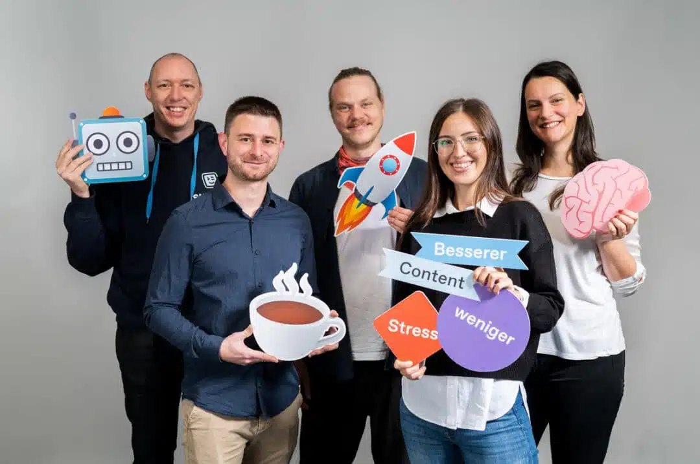

- Bildquelle: https://swat.io/wp-content/uploads/2021/11/Swat.io-Mentor-1080x718.jpeg
- Fundstelle: https://swat.io
- Format: 1080 × 718 px · webp
- Gründe: +6:grosse-quelldatei, +5:brauchbare-aufloesung, +6:produktbild-format
- Review: `needs_review` — zeigt das Bild wirklich die Software-Oberfläche?

### Kandidat 2 — Score 20

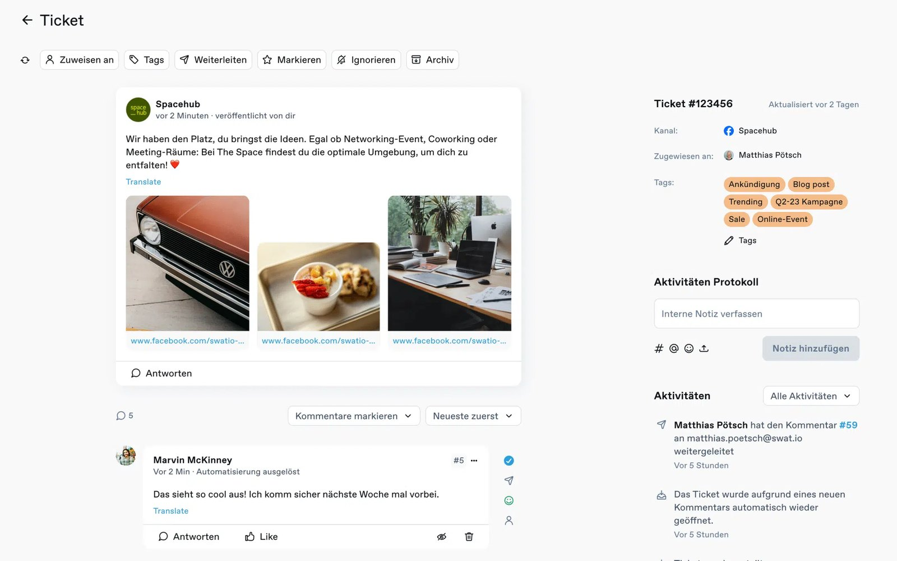

- Bildquelle: https://swat.io/wp-content/uploads/2024/07/Screens24_Album-DE-2160x1350.png
- Fundstelle: https://swat.io
- Format: 2160 × 1350 px · webp
- Gründe: +6:grosse-quelldatei, +8:hohe-aufloesung, +6:produktbild-format
- Review: `needs_review` — zeigt das Bild wirklich die Software-Oberfläche?

### Kandidat 3 — Score 17

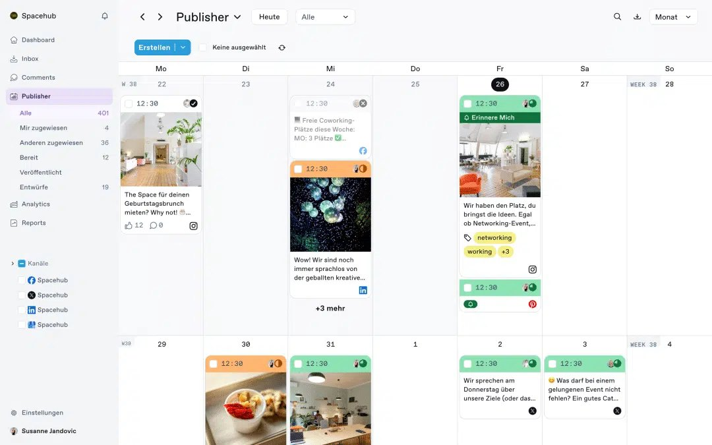

- Bildquelle: https://swat.io/wp-content/uploads/2024/07/Screens24_Calendar_DE-1080x675.png
- Fundstelle: https://swat.io
- Format: 1080 × 675 px · webp
- Gründe: +6:grosse-quelldatei, +5:brauchbare-aufloesung, +6:produktbild-format
- Review: `needs_review` — zeigt das Bild wirklich die Software-Oberfläche?

### Kandidat 4 — Score 20

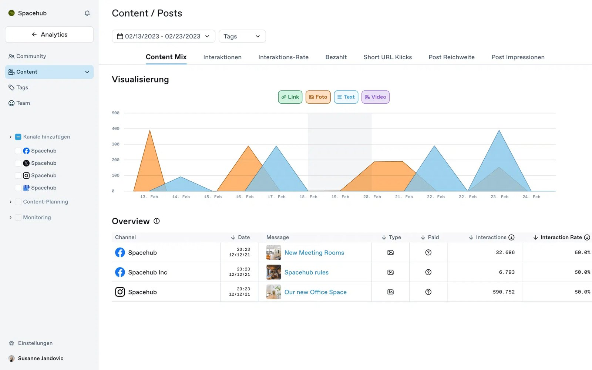

- Bildquelle: https://swat.io/wp-content/uploads/2024/07/Screens24_Content-Posts-DE-2160x1350.png
- Fundstelle: https://swat.io
- Format: 2160 × 1350 px · webp
- Gründe: +6:grosse-quelldatei, +8:hohe-aufloesung, +6:produktbild-format
- Review: `needs_review` — zeigt das Bild wirklich die Software-Oberfläche?

### Kandidat 5 — Score 17

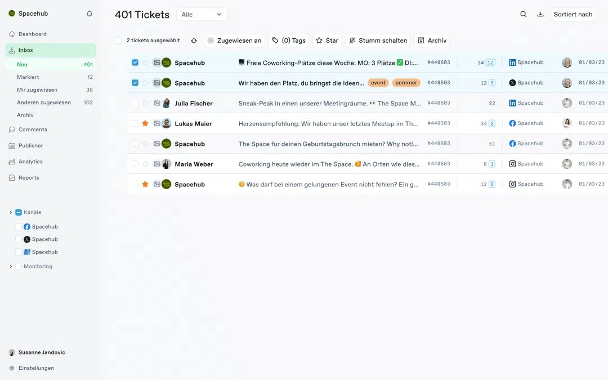

- Bildquelle: https://swat.io/wp-content/uploads/2024/07/Screens24_Edit-Inbox_DE-1080x675.png
- Fundstelle: https://swat.io
- Format: 1080 × 675 px · webp
- Gründe: +6:grosse-quelldatei, +5:brauchbare-aufloesung, +6:produktbild-format
- Review: `needs_review` — zeigt das Bild wirklich die Software-Oberfläche?

## tellent / Flip App (Flip GmbH)

### Kandidat 1 — Score 35

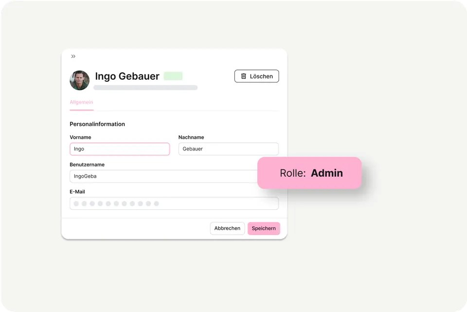

- Bildquelle: https://a.storyblok.com/f/300895/8f2ac79c4c/features-privacy-accordion-data.png/m/960x0/smart/
- Fundstelle: https://getflip.com/de/datenschutz
- Format: 960 × 641 px · webp
- Gründe: +8:platform, +6:portal, +5:app, +5:ui, +5:brauchbare-aufloesung, +6:produktbild-format
- Review: `needs_review` — zeigt das Bild wirklich die Software-Oberfläche?

### Kandidat 2 — Score 22

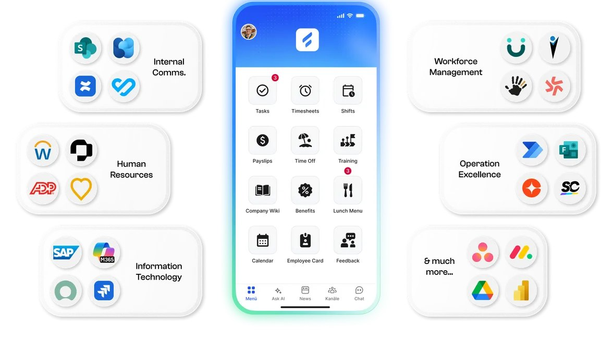

- Bildquelle: https://a.storyblok.com/f/300895/1920x1058/2a1151f407/flip_homepage_en.png/m/1176x0/smart/
- Fundstelle: https://getflip.com/de
- Format: 1176 × 648 px · webp
- Gründe: +5:ui, +6:grosse-quelldatei, +5:brauchbare-aufloesung, +6:produktbild-format
- Review: `needs_review` — zeigt das Bild wirklich die Software-Oberfläche?

### Kandidat 3 — Score 22

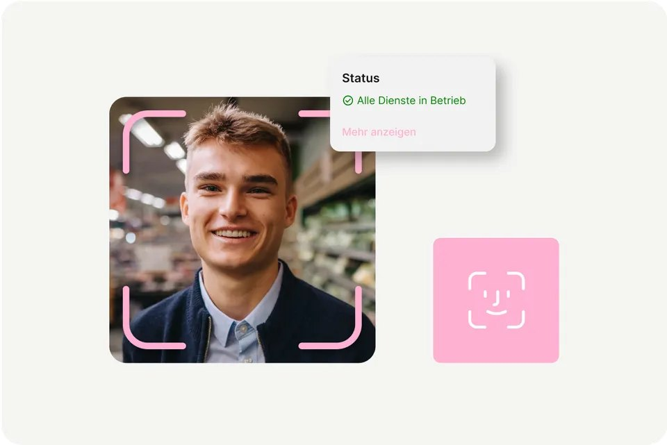

- Bildquelle: https://a.storyblok.com/f/300895/5c7102799d/features-privacy-accordion-tom.png/m/960x0/smart/
- Fundstelle: https://getflip.com/de/datenschutz
- Format: 960 × 641 px · webp
- Gründe: +6:portal, +5:app, +5:brauchbare-aufloesung, +6:produktbild-format
- Review: `needs_review` — zeigt das Bild wirklich die Software-Oberfläche?

### Kandidat 4 — Score 11

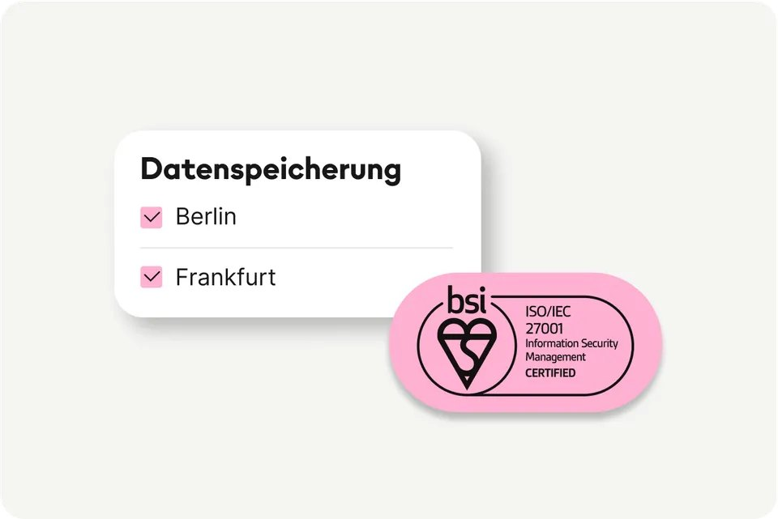

- Bildquelle: https://a.storyblok.com/f/300895/d6fbb10473/features-privacy-accordion-iso.png/m/960x0/smart/
- Fundstelle: https://getflip.com/de/datenschutz
- Format: 960 × 641 px · webp
- Gründe: +5:brauchbare-aufloesung, +6:produktbild-format
- Review: `needs_review` — zeigt das Bild wirklich die Software-Oberfläche?

### Kandidat 5 — Score 11

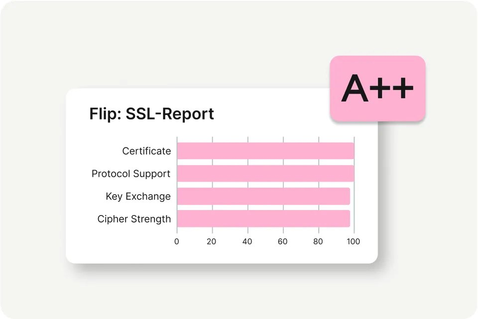

- Bildquelle: https://a.storyblok.com/f/300895/e4f2b633a5/features-privacy-accordion-encripted.png/m/960x0/smart/
- Fundstelle: https://getflip.com/de/datenschutz
- Format: 960 × 641 px · webp
- Gründe: +5:brauchbare-aufloesung, +6:produktbild-format
- Review: `needs_review` — zeigt das Bild wirklich die Software-Oberfläche?

## Beekeeper Deutschland GmbH

Keine ausreichend großen Bildkandidaten gefunden.

## Aleph Alpha GmbH

Keine ausreichend großen Bildkandidaten gefunden.

## DeepL SE

Keine ausreichend großen Bildkandidaten gefunden.

## Fabasoft Deutschland GmbH

Keine ausreichend großen Bildkandidaten gefunden.

## Form-Solutions GmbH

Keine ausreichend großen Bildkandidaten gefunden.

## Governikus GmbH & Co. KG

Keine ausreichend großen Bildkandidaten gefunden.

## Publicplan GmbH

Keine ausreichend großen Bildkandidaten gefunden.

## Secunet Security Networks AG

Keine ausreichend großen Bildkandidaten gefunden.

## Univention GmbH

### Kandidat 1 — Score 11

- Bildquelle: https://www.univention.de/wp-content/uploads/2024/01/ucs-at-school-1016x1024.jpg
- Fundstelle: https://univention.de
- Format: 1016 × 1024 px · webp
- Gründe: +6:grosse-quelldatei, +5:brauchbare-aufloesung
- Review: `needs_review` — zeigt das Bild wirklich die Software-Oberfläche?

## Viind GmbH

Keine ausreichend großen Bildkandidaten gefunden.

## aura flows (AURA Technologies)

Keine ausreichend großen Bildkandidaten gefunden.

## genua GmbH

### Kandidat 1 — Score 14

- Bildquelle: https://www.genua.de/fileadmin/_processed_/7/6/csm_kritis_anlage_AdobeStock_247850809_40e0ccde3f.jpg
- Fundstelle: https://genua.de
- Format: 1916 × 1076 px · jpeg
- Gründe: +8:hohe-aufloesung, +6:produktbild-format
- Review: `needs_review` — zeigt das Bild wirklich die Software-Oberfläche?

## Axians Infoma GmbH

Keine ausreichend großen Bildkandidaten gefunden.

## CONET Technologies AG

### Kandidat 1 — Score 11

- Bildquelle: https://www.conet.de/fileadmin/_processed_/9/6/csm_header_default_6a1b921ba0.webp
- Fundstelle: https://conet.de/de/datenschutz
- Format: 991 × 743 px · webp
- Gründe: +5:brauchbare-aufloesung, +6:produktbild-format
- Review: `needs_review` — zeigt das Bild wirklich die Software-Oberfläche?

## DeepSet GmbH (Haystack)

### Kandidat 1 — Score 22

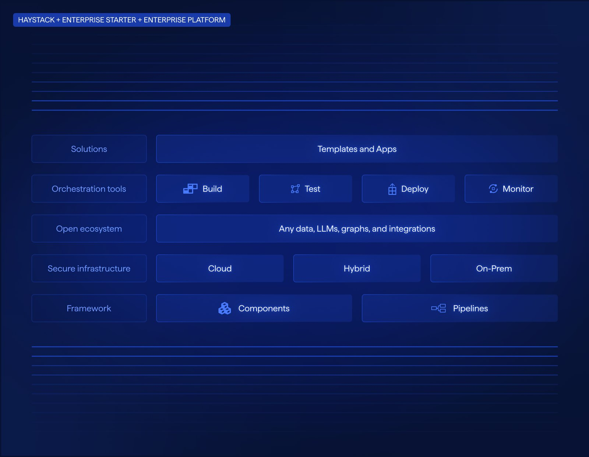

- Bildquelle: https://cdn.prod.website-files.com/6752ed90ddf74c98d49aa0a4/6925e0b4f34b0164266576f1_enterprise-platform.png
- Fundstelle: https://deepset.ai
- Format: 1890 × 1468 px · png
- Gründe: +8:platform, +8:hohe-aufloesung, +6:produktbild-format
- Review: `needs_review` — zeigt das Bild wirklich die Software-Oberfläche?

### Kandidat 2 — Score 14

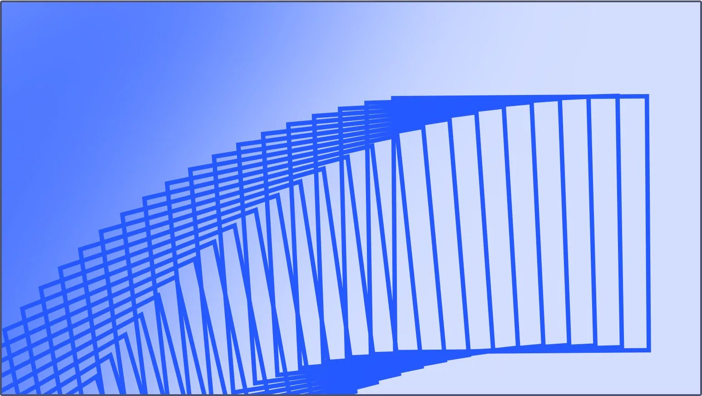

- Bildquelle: https://cdn.prod.website-files.com/6752ed90ddf74c98d49aa0a4/67613d161b69a1d2ec32851d_banner-background.webp
- Fundstelle: https://deepset.ai
- Format: 1546 × 871 px · webp
- Gründe: +8:hohe-aufloesung, +6:produktbild-format
- Review: `needs_review` — zeigt das Bild wirklich die Software-Oberfläche?

### Kandidat 3 — Score 14

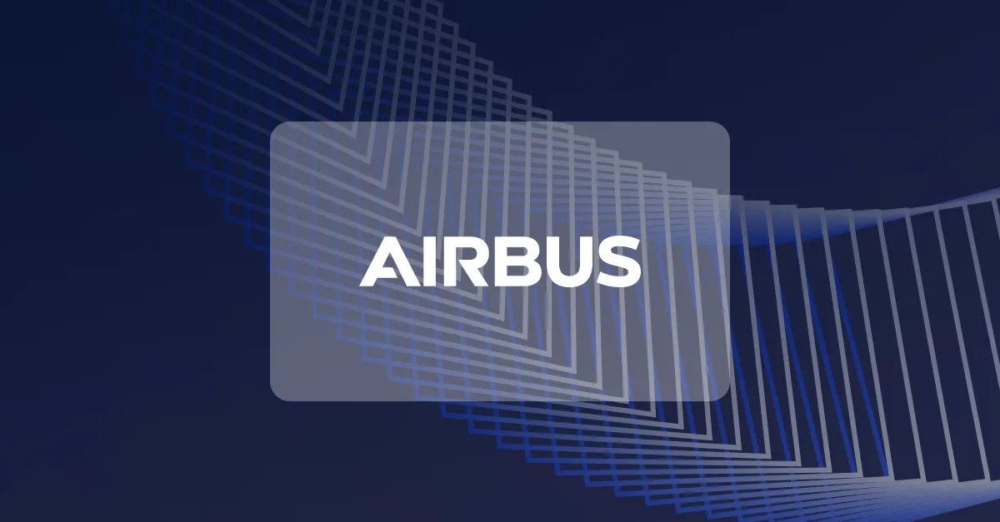

- Bildquelle: https://cdn.prod.website-files.com/6752ed90ddf74c98d49aa0a4/679e3bf32aa2f550c31f3362_Airbus_Case%20Study%20v1.0.webp
- Fundstelle: https://deepset.ai
- Format: 1200 × 627 px · webp
- Gründe: +8:hohe-aufloesung, +6:produktbild-format
- Review: `needs_review` — zeigt das Bild wirklich die Software-Oberfläche?

### Kandidat 4 — Score 8

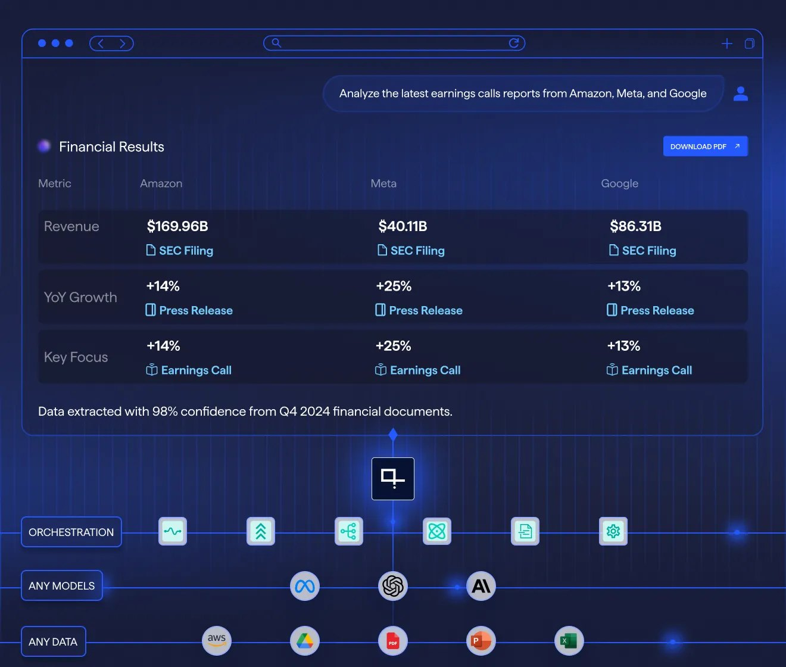

- Bildquelle: https://cdn.prod.website-files.com/6752ed90ddf74c98d49aa0a4/67a097c68e6a413218a52e08_graphic%20Intelligent%20Document%20Processing.webp
- Fundstelle: https://deepset.ai
- Format: 1320 × 1120 px · webp
- Gründe: +8:hohe-aufloesung
- Review: `needs_review` — zeigt das Bild wirklich die Software-Oberfläche?

### Kandidat 5 — Score 14

- Bildquelle: https://cdn.prod.website-files.com/6752ed90ddf74c98d49aa0a4/67a27c7cebc390b001f3b751_Die%20Zeit_Case%20Study_v1.0.webp
- Fundstelle: https://deepset.ai
- Format: 2400 × 1254 px · webp
- Gründe: +8:hohe-aufloesung, +6:produktbild-format
- Review: `needs_review` — zeigt das Bild wirklich die Software-Oberfläche?

## DriveLock SE

### Kandidat 1 — Score 22

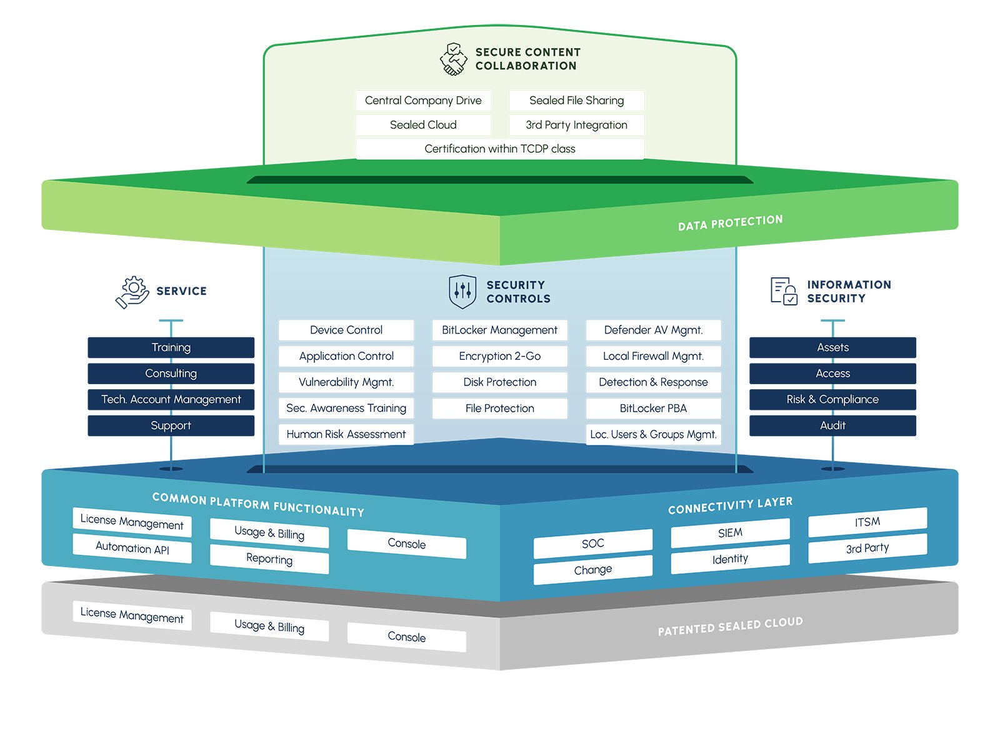

- Bildquelle: https://www.drivelock.com/hs-fs/hubfs/0_Bilder/Home/260415_DL_IDG_Platform_for_bright_backgrounds_s.png?width=1600&height=1167&name=260415_DL_IDG_Platform_for_bright_backgrounds_s.png
- Fundstelle: https://drivelock.com
- Format: 1600 × 1167 px · webp
- Gründe: +8:platform, +8:hohe-aufloesung, +6:produktbild-format
- Review: `needs_review` — zeigt das Bild wirklich die Software-Oberfläche?

### Kandidat 2 — Score 14

- Bildquelle: https://www.drivelock.com/hs-fs/hubfs/2023_Redesign/Backgrounds/Ausschnitte%20Keyvisual%20Kopie%205.jpg?width=1552&height=698&name=Ausschnitte%20Keyvisual%20Kopie%205.jpg
- Fundstelle: https://drivelock.com
- Format: 1552 × 698 px · webp
- Gründe: +8:hohe-aufloesung, +6:produktbild-format
- Review: `needs_review` — zeigt das Bild wirklich die Software-Oberfläche?

## Langdock GmbH

### Kandidat 1 — Score 11

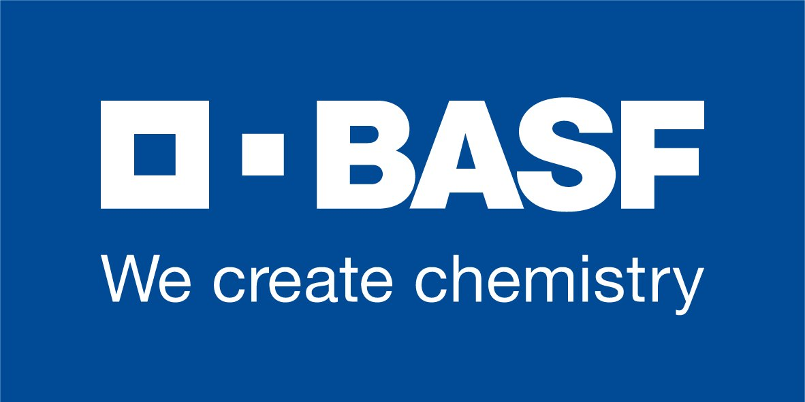

- Bildquelle: https://cdn.prod.website-files.com/69358127577725733df731fb/69e894a7980235630e6dc34c_BASFo_wh100db_3c-1.png
- Fundstelle: https://langdock.com/de/security
- Format: 1182 × 591 px · png
- Gründe: +5:brauchbare-aufloesung, +6:produktbild-format
- Review: `needs_review` — zeigt das Bild wirklich die Software-Oberfläche?

## Materna Virtual Solution GmbH

### Kandidat 1 — Score 14

- Bildquelle: https://www.virtual-solution.com/wp-content/uploads/02_Artikel-1.jpg
- Fundstelle: https://virtual-solution.com
- Format: 1600 × 1060 px · jpeg
- Gründe: +8:hohe-aufloesung, +6:produktbild-format
- Review: `needs_review` — zeigt das Bild wirklich die Software-Oberfläche?

### Kandidat 2 — Score 14

- Bildquelle: https://www.virtual-solution.com/wp-content/uploads/03_Artikel-4.jpg
- Fundstelle: https://virtual-solution.com
- Format: 1600 × 1060 px · jpeg
- Gründe: +8:hohe-aufloesung, +6:produktbild-format
- Review: `needs_review` — zeigt das Bild wirklich die Software-Oberfläche?

## Publicplan / Liferay DXP Public

Keine ausreichend großen Bildkandidaten gefunden.

## Rohde & Schwarz Cybersecurity GmbH

Keine ausreichend großen Bildkandidaten gefunden.

## ConsenseData / enclaive GmbH

Keine ausreichend großen Bildkandidaten gefunden.

## DATAKOM GmbH

### Kandidat 1 — Score 17

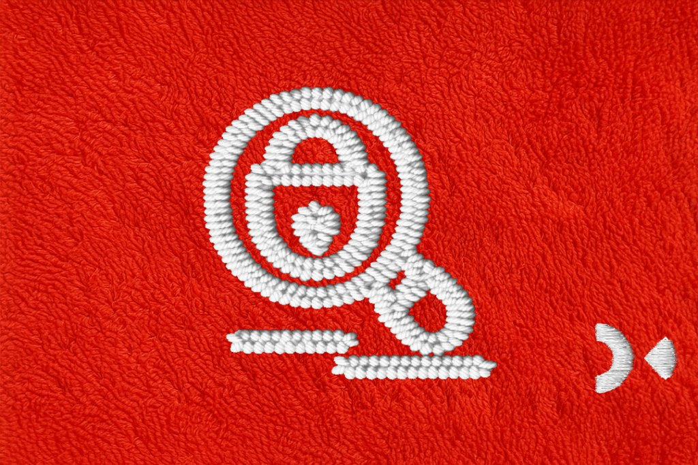

- Bildquelle: https://datakom.de/wp-content/uploads/2026/05/39_digitalForensics_1080-1024x683.png
- Fundstelle: https://datakom.de
- Format: 1024 × 683 px · png
- Gründe: +6:grosse-quelldatei, +5:brauchbare-aufloesung, +6:produktbild-format
- Review: `needs_review` — zeigt das Bild wirklich die Software-Oberfläche?

### Kandidat 2 — Score 17

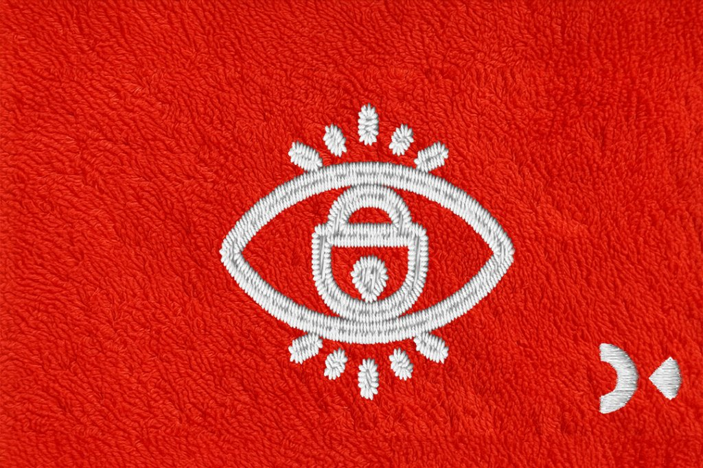

- Bildquelle: https://datakom.de/wp-content/uploads/2026/06/40_pciDssCompliance_1080-1024x683.png
- Fundstelle: https://datakom.de
- Format: 1024 × 683 px · png
- Gründe: +6:grosse-quelldatei, +5:brauchbare-aufloesung, +6:produktbild-format
- Review: `needs_review` — zeigt das Bild wirklich die Software-Oberfläche?

### Kandidat 3 — Score 17

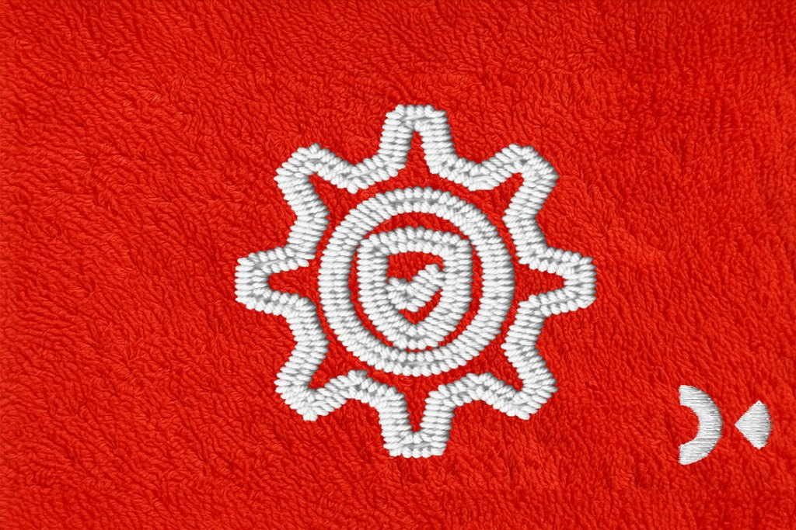

- Bildquelle: https://datakom.de/wp-content/uploads/2026/06/41_IndustryAnalysis_1080-1024x683.png
- Fundstelle: https://datakom.de
- Format: 1024 × 683 px · png
- Gründe: +6:grosse-quelldatei, +5:brauchbare-aufloesung, +6:produktbild-format
- Review: `needs_review` — zeigt das Bild wirklich die Software-Oberfläche?

## G DATA CyberDefense AG

Keine ausreichend großen Bildkandidaten gefunden.

## Mistral AI (DACH-Aktivitäten)

### Kandidat 1 — Score 14

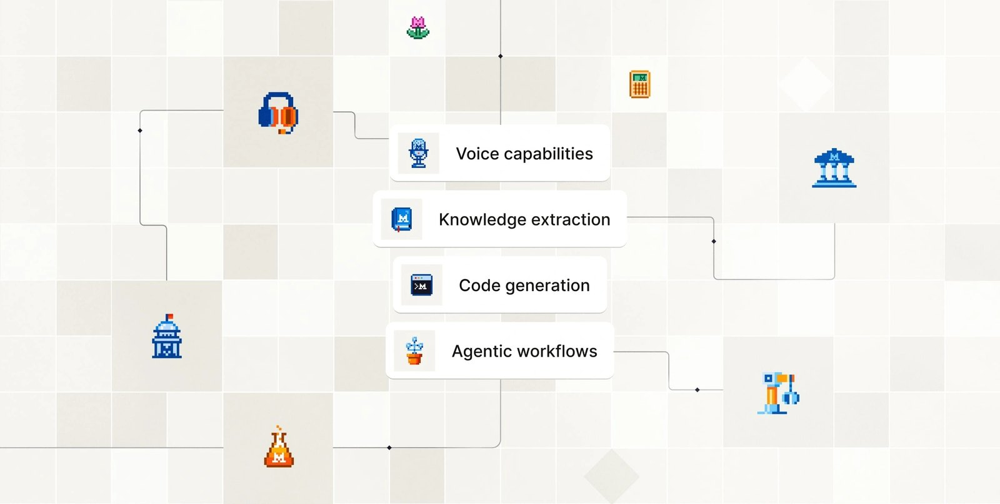

- Bildquelle: https://mistral.ai/_astro/Advanced%20R_D_Z1aAB1x.webp?dpl=6a3c194ba5ef330008aaa4d8
- Fundstelle: https://mistral.ai
- Format: 2400 × 1211 px · webp
- Gründe: +8:hohe-aufloesung, +6:produktbild-format
- Review: `needs_review` — zeigt das Bild wirklich die Software-Oberfläche?

### Kandidat 2 — Score 14

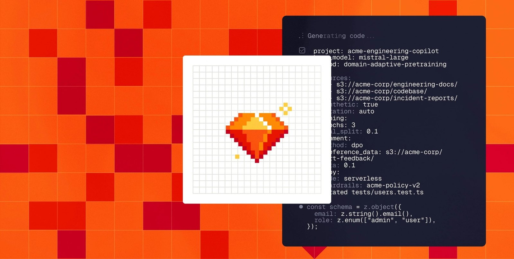

- Bildquelle: https://mistral.ai/_astro/Forge_1ftrWd.webp?dpl=6a3c194ba5ef330008aaa4d8
- Fundstelle: https://mistral.ai
- Format: 2400 × 1211 px · webp
- Gründe: +8:hohe-aufloesung, +6:produktbild-format
- Review: `needs_review` — zeigt das Bild wirklich die Software-Oberfläche?

### Kandidat 3 — Score 14

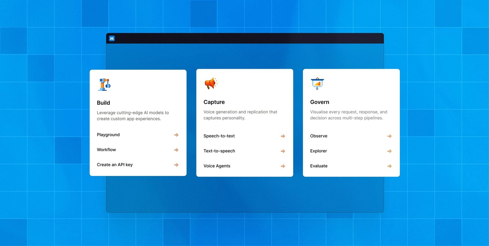

- Bildquelle: https://mistral.ai/_astro/Studio_yuEsE.webp?dpl=6a3c194ba5ef330008aaa4d8
- Fundstelle: https://mistral.ai
- Format: 2400 × 1211 px · webp
- Gründe: +8:hohe-aufloesung, +6:produktbild-format
- Review: `needs_review` — zeigt das Bild wirklich die Software-Oberfläche?

### Kandidat 4 — Score 14

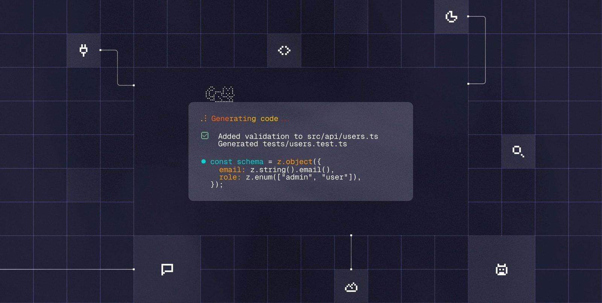

- Bildquelle: https://mistral.ai/_astro/Vibe%20for%20code_ZVhAxB.webp?dpl=6a3c194ba5ef330008aaa4d8
- Fundstelle: https://mistral.ai
- Format: 2400 × 1211 px · webp
- Gründe: +8:hohe-aufloesung, +6:produktbild-format
- Review: `needs_review` — zeigt das Bild wirklich die Software-Oberfläche?

### Kandidat 5 — Score 14

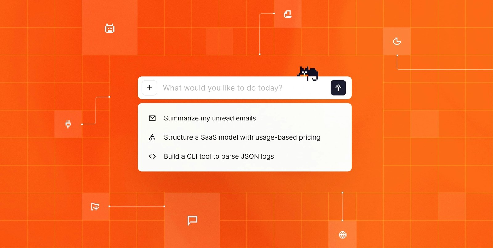

- Bildquelle: https://mistral.ai/_astro/Vibe_H432M.webp?dpl=6a3c194ba5ef330008aaa4d8
- Fundstelle: https://mistral.ai
- Format: 2400 × 1211 px · webp
- Gründe: +8:hohe-aufloesung, +6:produktbild-format
- Review: `needs_review` — zeigt das Bild wirklich die Software-Oberfläche?

## Utimaco GmbH

Keine ausreichend großen Bildkandidaten gefunden.

## MeisterLabs GmbH (MeisterTask)

### Kandidat 1 — Score 20

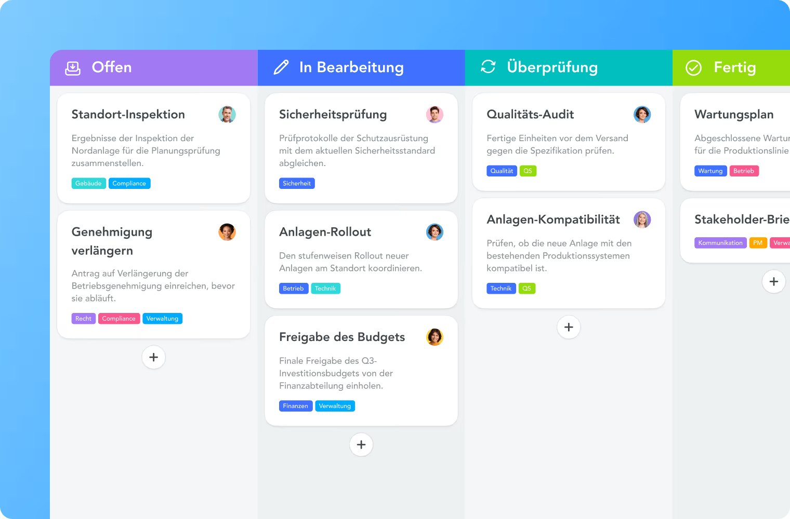

- Bildquelle: https://www.meistertask.com/_next/image?url=https%3A%2F%2Fa.storyblok.com%2Ff%2F289344%2F1521x1001%2F8646432963%2Fui-image_project-management_de.png%2Fm%2F&w=3840&q=75
- Fundstelle: https://meistertask.com
- Format: 1520 × 1000 px · avif
- Gründe: +6:grosse-quelldatei, +8:hohe-aufloesung, +6:produktbild-format
- Review: `needs_review` — zeigt das Bild wirklich die Software-Oberfläche?

### Kandidat 2 — Score 20

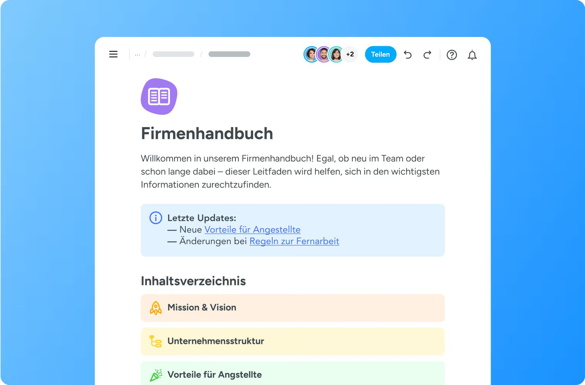

- Bildquelle: https://www.meistertask.com/_next/image?url=https%3A%2F%2Fa.storyblok.com%2Ff%2F289344%2F1521x1001%2Fcc9fc25abb%2Fui-image_documentation_de.png%2Fm%2F&w=3840&q=75
- Fundstelle: https://meistertask.com
- Format: 1521 × 1000 px · avif
- Gründe: +6:grosse-quelldatei, +8:hohe-aufloesung, +6:produktbild-format
- Review: `needs_review` — zeigt das Bild wirklich die Software-Oberfläche?

### Kandidat 3 — Score 14

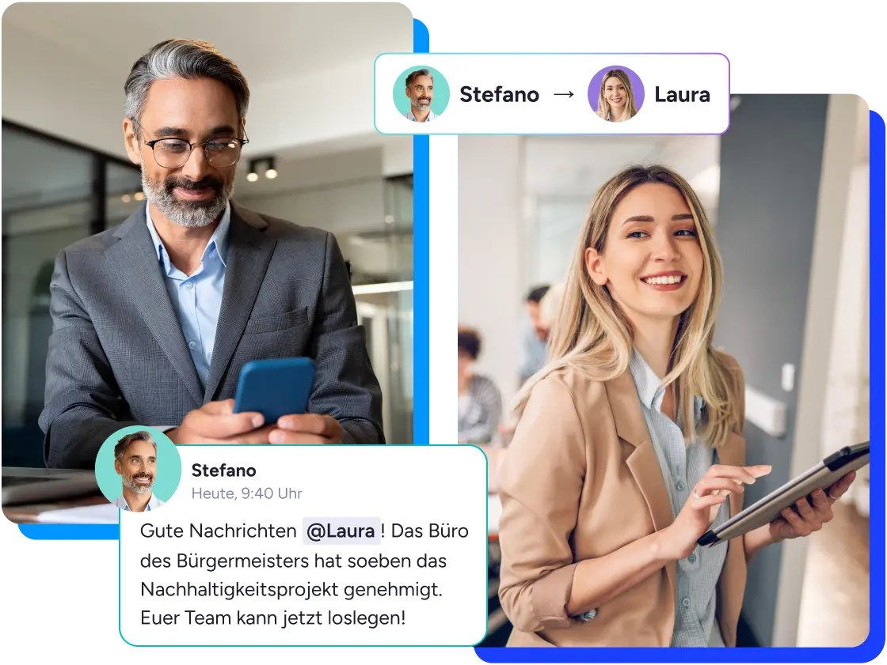

- Bildquelle: https://www.meistertask.com/_next/image?url=https%3A%2F%2Fa.storyblok.com%2Ff%2F289344%2F1120x841%2F94fee5b79e%2Findustries_hero_public-sector_de.png%2Fm%2F&w=3840&q=75
- Fundstelle: https://meistertask.com
- Format: 1120 × 841 px · webp
- Gründe: -3:hero, +6:grosse-quelldatei, +5:brauchbare-aufloesung, +6:produktbild-format
- Review: `needs_review` — zeigt das Bild wirklich die Software-Oberfläche?

### Kandidat 4 — Score 14

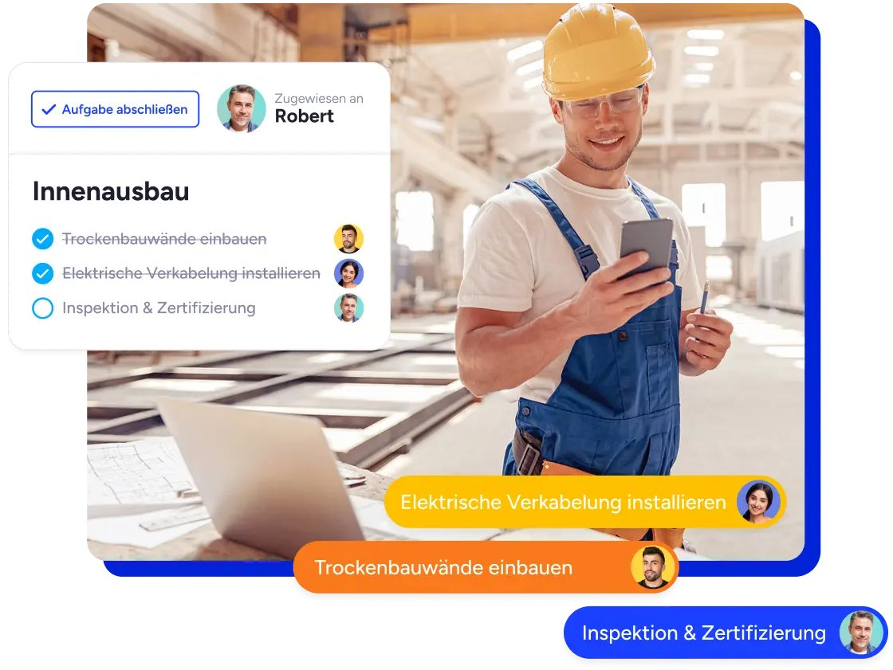

- Bildquelle: https://www.meistertask.com/_next/image?url=https%3A%2F%2Fa.storyblok.com%2Ff%2F289344%2F1120x841%2F955b6b23ed%2Findustries_hero_manufacturing_de.png%2Fm%2F&w=3840&q=75
- Fundstelle: https://meistertask.com
- Format: 1120 × 841 px · webp
- Gründe: -3:hero, +6:grosse-quelldatei, +5:brauchbare-aufloesung, +6:produktbild-format
- Review: `needs_review` — zeigt das Bild wirklich die Software-Oberfläche?

### Kandidat 5 — Score 14

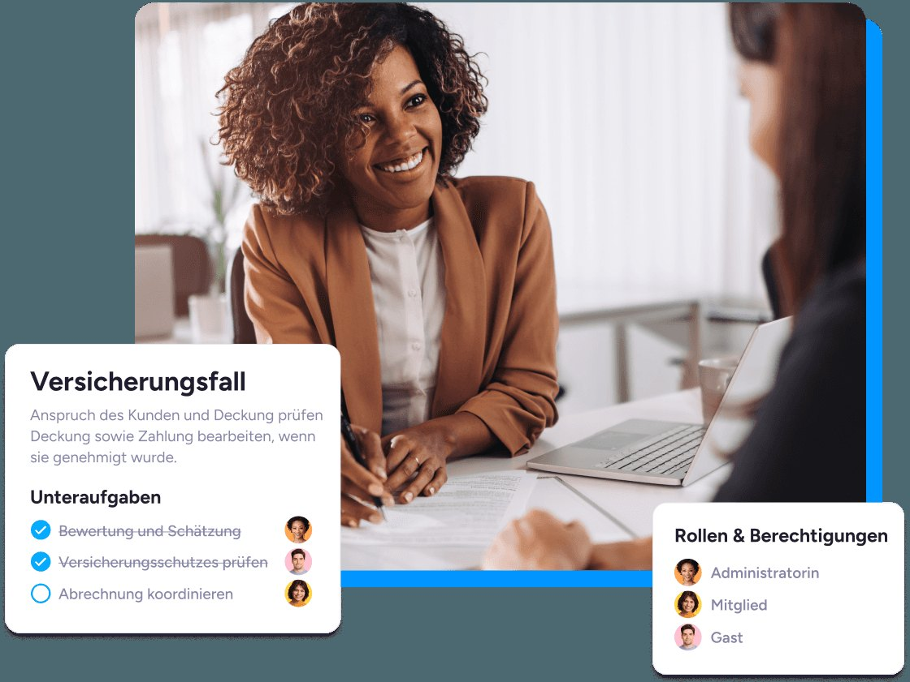

- Bildquelle: https://www.meistertask.com/_next/image?url=https%3A%2F%2Fa.storyblok.com%2Ff%2F289344%2F1120x841%2Fa96d0a556d%2Findustries_hero_insurance_de.png%2Fm%2F&w=3840&q=75
- Fundstelle: https://meistertask.com
- Format: 1120 × 841 px · png
- Gründe: -3:hero, +6:grosse-quelldatei, +5:brauchbare-aufloesung, +6:produktbild-format
- Review: `needs_review` — zeigt das Bild wirklich die Software-Oberfläche?

## Nextcloud GmbH

Keine ausreichend großen Bildkandidaten gefunden.

## Stackfield GmbH

### Kandidat 1 — Score 11

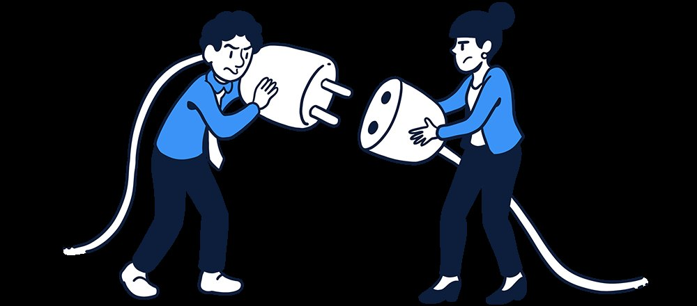

- Bildquelle: https://www.stackfield.com/images/offline2@2x.png
- Fundstelle: https://stackfield.com/datenschutz
- Format: 1000 × 440 px · png
- Gründe: +5:brauchbare-aufloesung, +6:produktbild-format
- Review: `needs_review` — zeigt das Bild wirklich die Software-Oberfläche?

### Kandidat 2 — Score 11

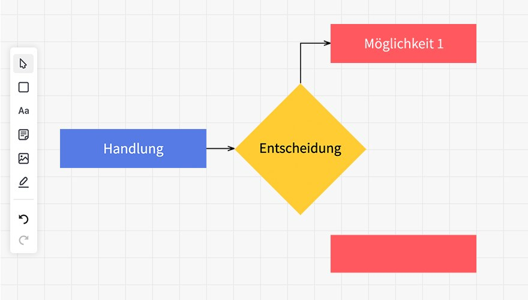

- Bildquelle: https://www.stackfield.com/images/startimage1_v5_de.png
- Fundstelle: https://stackfield.com
- Format: 880 × 500 px · png
- Gründe: +5:brauchbare-aufloesung, +6:produktbild-format
- Review: `needs_review` — zeigt das Bild wirklich die Software-Oberfläche?

### Kandidat 3 — Score 11

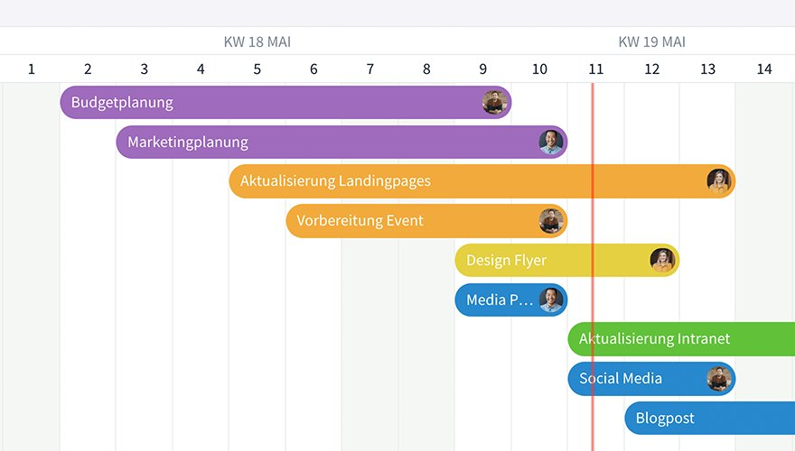

- Bildquelle: https://www.stackfield.com/images/startimage2_v1_de.png
- Fundstelle: https://stackfield.com
- Format: 880 × 500 px · png
- Gründe: +5:brauchbare-aufloesung, +6:produktbild-format
- Review: `needs_review` — zeigt das Bild wirklich die Software-Oberfläche?

### Kandidat 4 — Score 11

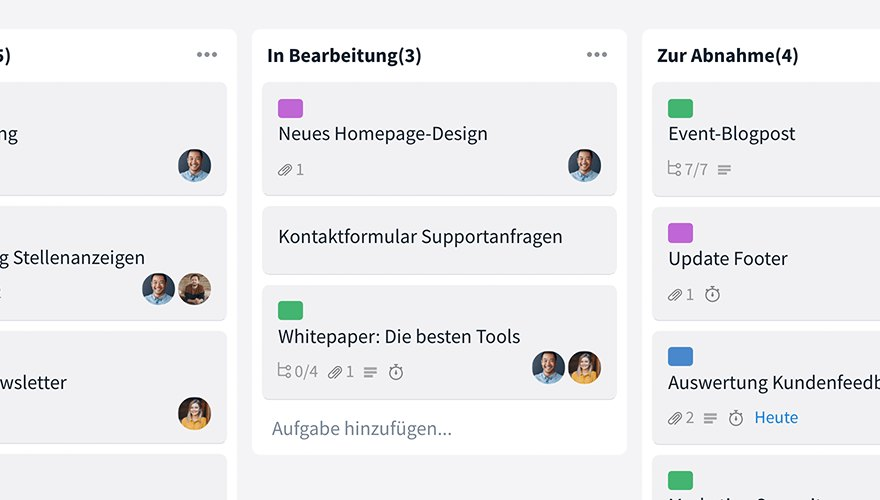

- Bildquelle: https://www.stackfield.com/images/startimage3_v2_de.png
- Fundstelle: https://stackfield.com
- Format: 880 × 500 px · png
- Gründe: +5:brauchbare-aufloesung, +6:produktbild-format
- Review: `needs_review` — zeigt das Bild wirklich die Software-Oberfläche?

### Kandidat 5 — Score 11

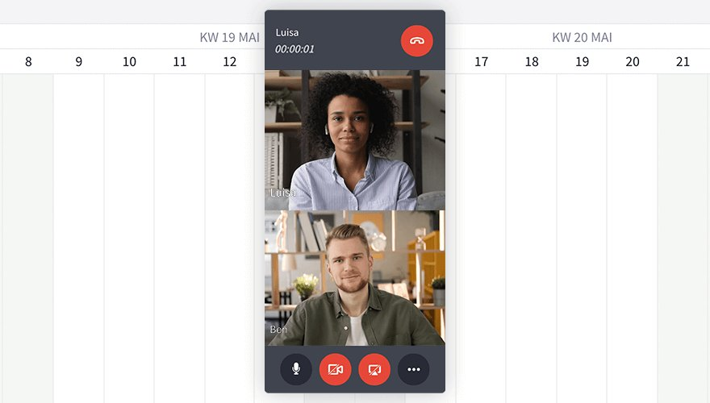

- Bildquelle: https://www.stackfield.com/images/startimage4_v2_de.png
- Fundstelle: https://stackfield.com
- Format: 880 × 500 px · png
- Gründe: +5:brauchbare-aufloesung, +6:produktbild-format
- Review: `needs_review` — zeigt das Bild wirklich die Software-Oberfläche?

## Wire Swiss GmbH (Berlin)

### Kandidat 1 — Score 14

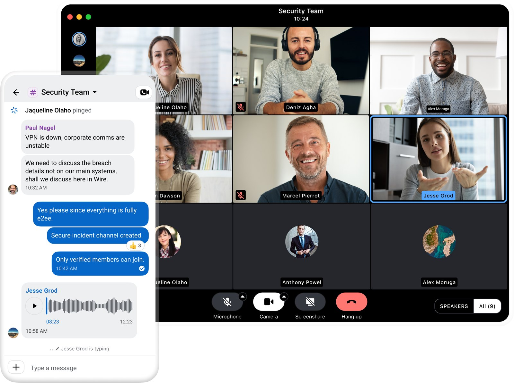

- Bildquelle: https://wire.com/hs-fs/hubfs/Wire%202025-11-27%20at%2009_25.png?width=2400&height=1792&name=Wire%202025-11-27%20at%2009_25.png
- Fundstelle: https://wire.com
- Format: 2400 × 1792 px · webp
- Gründe: +8:hohe-aufloesung, +6:produktbild-format
- Review: `needs_review` — zeigt das Bild wirklich die Software-Oberfläche?

## Awesome Technologies (matrix / Element)

### Kandidat 1 — Score 14

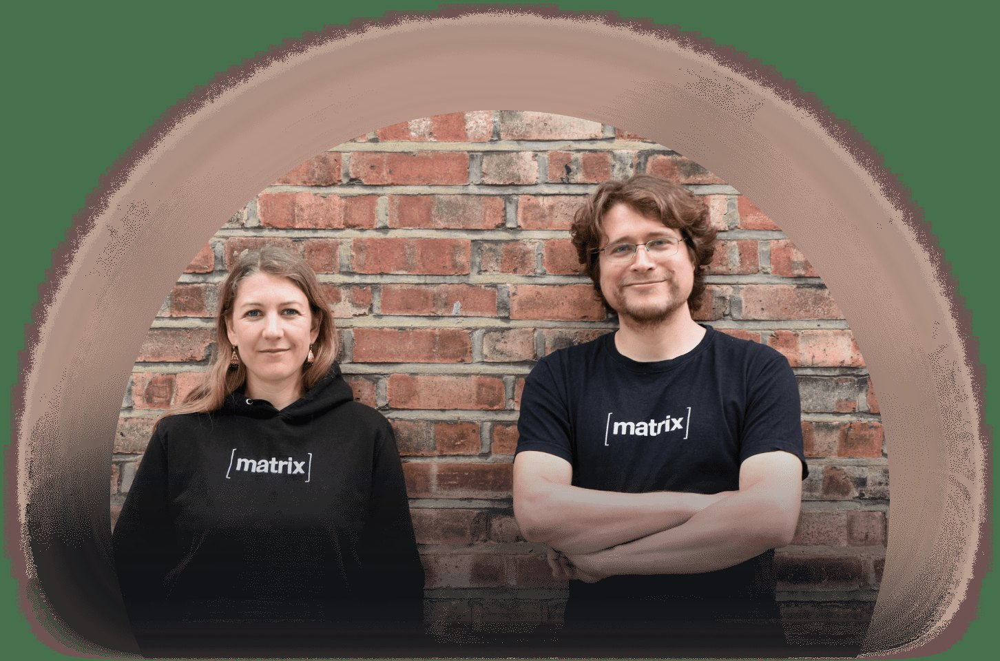

- Bildquelle: https://element.io/assets-32bb636196f91ed59d7a49190e26b42c/5ef25c0d30ee3108da4c25e9/65aaa1c373d684ff370bb6bc_matrix-founders-crop.png
- Fundstelle: https://element.io
- Format: 1452 × 960 px · png
- Gründe: +8:hohe-aufloesung, +6:produktbild-format
- Review: `needs_review` — zeigt das Bild wirklich die Software-Oberfläche?

## Open-Xchange AG

### Kandidat 1 — Score 18

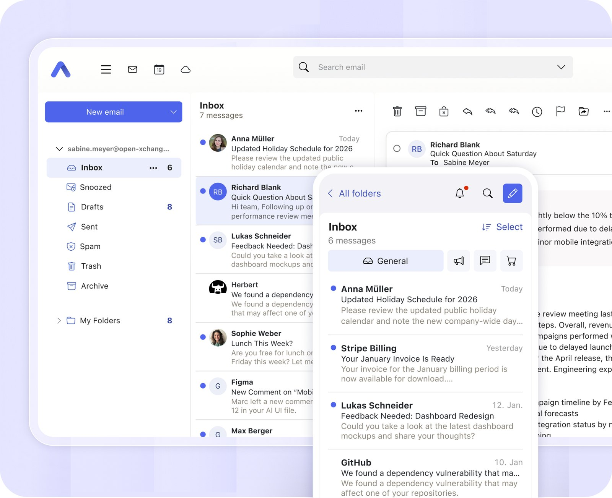

- Bildquelle: https://www.open-xchange.com/hubfs/App_Suite_UI-opt.png
- Fundstelle: https://open-xchange.com/de
- Format: 2000 × 1629 px · png
- Gründe: +5:app, +5:ui, +8:hohe-aufloesung
- Review: `needs_review` — zeigt das Bild wirklich die Software-Oberfläche?

### Kandidat 2 — Score 19

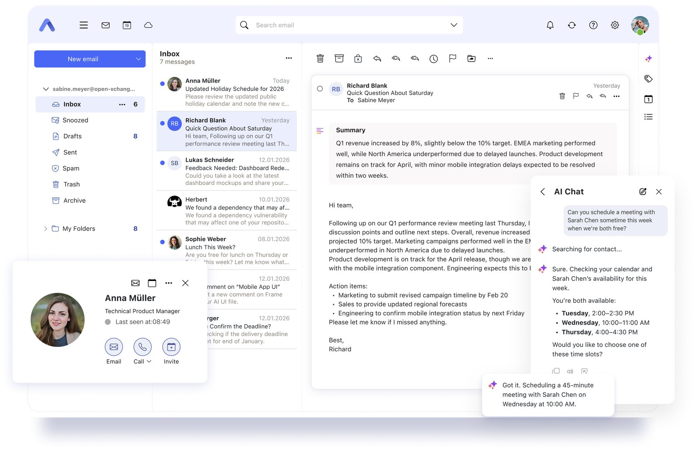

- Bildquelle: https://www.open-xchange.com/hs-fs/hubfs/App_Suite_Home.png
- Fundstelle: https://open-xchange.com/de
- Format: 3328 × 2148 px · png
- Gründe: +5:app, +8:hohe-aufloesung, +6:produktbild-format
- Review: `needs_review` — zeigt das Bild wirklich die Software-Oberfläche?

## awork GmbH

### Kandidat 1 — Score 14

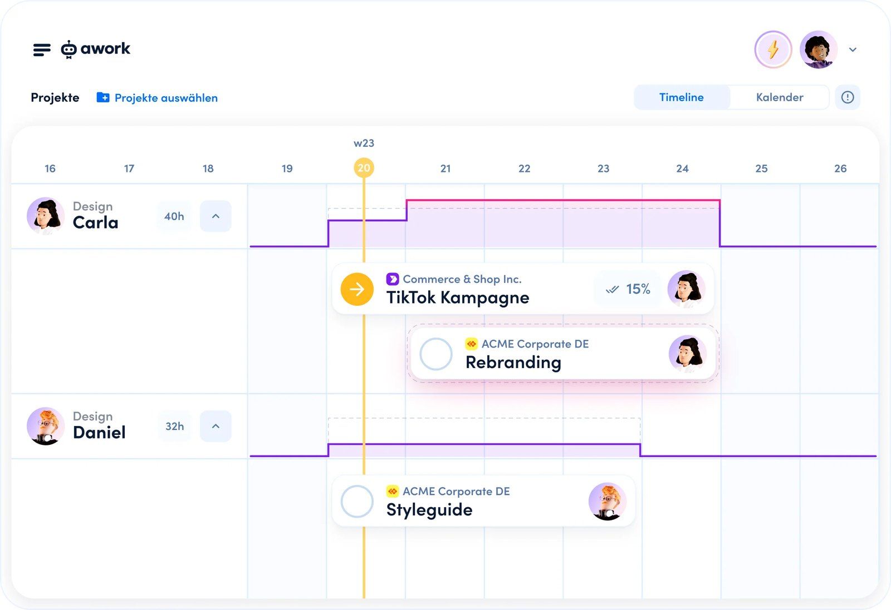

- Bildquelle: https://cdn.prod.website-files.com/6418f5bfe5bc0a3438109c1d/67068fbd236f5708c2ec8147_DE_Workload.webp
- Fundstelle: https://awork.com
- Format: 2199 × 1508 px · webp
- Gründe: +8:hohe-aufloesung, +6:produktbild-format
- Review: `needs_review` — zeigt das Bild wirklich die Software-Oberfläche?

### Kandidat 2 — Score 14

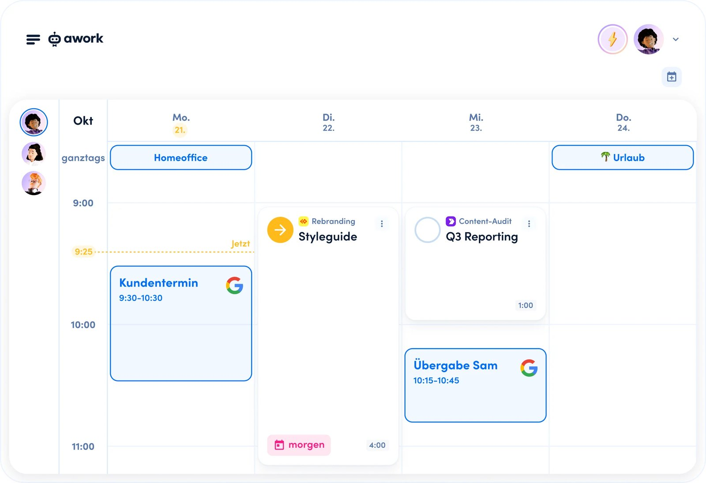

- Bildquelle: https://cdn.prod.website-files.com/6418f5bfe5bc0a3438109c1d/67068fbd2db04ce4ff83f3a0_DE_Kalender.webp
- Fundstelle: https://awork.com
- Format: 2199 × 1508 px · webp
- Gründe: +8:hohe-aufloesung, +6:produktbild-format
- Review: `needs_review` — zeigt das Bild wirklich die Software-Oberfläche?

### Kandidat 3 — Score 14

- Bildquelle: https://cdn.prod.website-files.com/6418f5bfe5bc0a3438109c1d/67068fbd32f1ff6a1277dbd3_DE_Timetracking.webp
- Fundstelle: https://awork.com
- Format: 2199 × 1517 px · webp
- Gründe: +8:hohe-aufloesung, +6:produktbild-format
- Review: `needs_review` — zeigt das Bild wirklich die Software-Oberfläche?

### Kandidat 4 — Score 14

- Bildquelle: https://cdn.prod.website-files.com/6418f5bfe5bc0a3438109c1d/67068fbd84bdb2685dbbd4d0_DE_Projekt-Timeline-zoom.webp
- Fundstelle: https://awork.com
- Format: 2199 × 1508 px · webp
- Gründe: +8:hohe-aufloesung, +6:produktbild-format
- Review: `needs_review` — zeigt das Bild wirklich die Software-Oberfläche?

## factro (Schuchert Managementberatung)

### Kandidat 1 — Score 14

- Bildquelle: https://www.factro.de/wp-content/uploads/2026/01/psb.webp
- Fundstelle: https://factro.de
- Format: 2562 × 1583 px · webp
- Gründe: +8:hohe-aufloesung, +6:produktbild-format
- Review: `needs_review` — zeigt das Bild wirklich die Software-Oberfläche?

## Taskworld (IYOPRO GmbH)

Keine ausreichend großen Bildkandidaten gefunden.

## ownCloud (Kiteworks)

### Kandidat 1 — Score 19

- Bildquelle: https://owncloud.com/wp-content/uploads/2020/08/Home-UI.png
- Fundstelle: https://owncloud.com
- Format: 1839 × 1185 px · png
- Gründe: +5:ui, +8:hohe-aufloesung, +6:produktbild-format
- Review: `needs_review` — zeigt das Bild wirklich die Software-Oberfläche?

### Kandidat 2 — Score 14

- Bildquelle: https://owncloud.com/wp-content/uploads/2020/06/ControlData-2.png
- Fundstelle: https://owncloud.com
- Format: 2252 × 1656 px · png
- Gründe: +8:hohe-aufloesung, +6:produktbild-format
- Review: `needs_review` — zeigt das Bild wirklich die Software-Oberfläche?

### Kandidat 3 — Score 14

- Bildquelle: https://owncloud.com/wp-content/uploads/2020/06/Productivity-1.png
- Fundstelle: https://owncloud.com
- Format: 2420 × 1676 px · png
- Gründe: +8:hohe-aufloesung, +6:produktbild-format
- Review: `needs_review` — zeigt das Bild wirklich die Software-Oberfläche?

### Kandidat 4 — Score 14

- Bildquelle: https://owncloud.com/wp-content/uploads/2022/11/5107998E-B29E-4485-AE1C-43EF601E1A67.png
- Fundstelle: https://owncloud.com
- Format: 1374 × 972 px · png
- Gründe: +8:hohe-aufloesung, +6:produktbild-format
- Review: `needs_review` — zeigt das Bild wirklich die Software-Oberfläche?

### Kandidat 5 — Score 14

- Bildquelle: https://owncloud.com/wp-content/uploads/2022/11/example.png
- Fundstelle: https://owncloud.com
- Format: 2878 × 1410 px · png
- Gründe: +8:hohe-aufloesung, +6:produktbild-format
- Review: `needs_review` — zeigt das Bild wirklich die Software-Oberfläche?

## HR4YOU (Büsch GmbH)

### Kandidat 1 — Score 17

- Bildquelle: https://www.hr4you.de/wp-content/uploads/2025/01/Active-Sourcing-1024x680.png
- Fundstelle: https://hr4you.de
- Format: 1024 × 680 px · png
- Gründe: +6:grosse-quelldatei, +5:brauchbare-aufloesung, +6:produktbild-format
- Review: `needs_review` — zeigt das Bild wirklich die Software-Oberfläche?

### Kandidat 2 — Score 17

- Bildquelle: https://www.hr4you.de/wp-content/uploads/2025/01/CV-Parsing-1024x680.png
- Fundstelle: https://hr4you.de
- Format: 1024 × 680 px · png
- Gründe: +6:grosse-quelldatei, +5:brauchbare-aufloesung, +6:produktbild-format
- Review: `needs_review` — zeigt das Bild wirklich die Software-Oberfläche?

### Kandidat 3 — Score 17

- Bildquelle: https://www.hr4you.de/wp-content/uploads/2025/01/KI-Assistent-1024x680.png
- Fundstelle: https://hr4you.de
- Format: 1024 × 680 px · png
- Gründe: +6:grosse-quelldatei, +5:brauchbare-aufloesung, +6:produktbild-format
- Review: `needs_review` — zeigt das Bild wirklich die Software-Oberfläche?

### Kandidat 4 — Score 17

- Bildquelle: https://www.hr4you.de/wp-content/uploads/2025/01/Multichanneling-1024x680.png
- Fundstelle: https://hr4you.de
- Format: 1024 × 680 px · png
- Gründe: +6:grosse-quelldatei, +5:brauchbare-aufloesung, +6:produktbild-format
- Review: `needs_review` — zeigt das Bild wirklich die Software-Oberfläche?

### Kandidat 5 — Score 17

- Bildquelle: https://www.hr4you.de/wp-content/uploads/2025/01/Smart_Search-1024x680.png
- Fundstelle: https://hr4you.de
- Format: 1024 × 680 px · png
- Gründe: +6:grosse-quelldatei, +5:brauchbare-aufloesung, +6:produktbild-format
- Review: `needs_review` — zeigt das Bild wirklich die Software-Oberfläche?

## P&I Personal & Informatik AG (LOGA)

Keine ausreichend großen Bildkandidaten gefunden.

## zfm – Zentrum für Management- und Personalberatung

Keine ausreichend großen Bildkandidaten gefunden.

## milch & zucker Talent Acquisition

Keine ausreichend großen Bildkandidaten gefunden.

## rexx systems GmbH

### Kandidat 1 — Score 37

- Bildquelle: https://cdn.rexx-systems.com/wp-content/uploads/2026/03/hr-software-loesungen-als-cloud-oder-on-premise-1024x576.webp
- Fundstelle: https://rexx-systems.com
- Format: 1024 × 576 px · webp
- Gründe: +12:dashboard, +8:software, +6:grosse-quelldatei, +5:brauchbare-aufloesung, +6:produktbild-format
- Review: `needs_review` — zeigt das Bild wirklich die Software-Oberfläche?

### Kandidat 2 — Score 34

- Bildquelle: https://cdn.rexx-systems.com/wp-content/uploads/2026/03/hr-software-360-grad-feedback-zielvereinbarungen-ki.webp
- Fundstelle: https://rexx-systems.com
- Format: 1920 × 1080 px · webp
- Gründe: +12:dashboard, +8:software, +8:hohe-aufloesung, +6:produktbild-format
- Review: `needs_review` — zeigt das Bild wirklich die Software-Oberfläche?

### Kandidat 3 — Score 23

- Bildquelle: https://cdn.rexx-systems.com/wp-content/uploads/2026/03/rexx-systems-home-iso-und-dsgvo.webp
- Fundstelle: https://rexx-systems.com
- Format: 800 × 447 px · webp
- Gründe: +12:dashboard, +8:software, -8:person, +5:brauchbare-aufloesung, +6:produktbild-format
- Review: `needs_review` — zeigt das Bild wirklich die Software-Oberfläche?

### Kandidat 4 — Score 14

- Bildquelle: https://cdn.rexx-systems.com/wp-content/uploads/2026/03/rexx-systems-bewerbermanagement.webp
- Fundstelle: https://rexx-systems.com
- Format: 1920 × 1080 px · webp
- Gründe: +8:hohe-aufloesung, +6:produktbild-format
- Review: `needs_review` — zeigt das Bild wirklich die Software-Oberfläche?

### Kandidat 5 — Score 14

- Bildquelle: https://cdn.rexx-systems.com/wp-content/uploads/2026/03/rexx-systems_multiposting-jobportale-stellenanzeigen.webp
- Fundstelle: https://rexx-systems.com
- Format: 1920 × 1080 px · webp
- Gründe: +8:hohe-aufloesung, +6:produktbild-format
- Review: `needs_review` — zeigt das Bild wirklich die Software-Oberfläche?

## softgarden e-recruiting GmbH

### Kandidat 1 — Score 16

- Bildquelle: https://softgarden.com/app/uploads/2025/09/grafik-14-1024x1024.png
- Fundstelle: https://softgarden.com/de
- Format: 1024 × 1024 px · png
- Gründe: +5:app, +6:grosse-quelldatei, +5:brauchbare-aufloesung
- Review: `needs_review` — zeigt das Bild wirklich die Software-Oberfläche?

### Kandidat 2 — Score 16

- Bildquelle: https://softgarden.com/app/uploads/2025/09/grafik-6-1024x854.png
- Fundstelle: https://softgarden.com/de
- Format: 1024 × 854 px · png
- Gründe: +5:app, +6:grosse-quelldatei, +5:brauchbare-aufloesung
- Review: `needs_review` — zeigt das Bild wirklich die Software-Oberfläche?

### Kandidat 3 — Score 22

- Bildquelle: https://softgarden.com/app/uploads/2025/09/srs-advantage-02-de-1024x768.webp
- Fundstelle: https://softgarden.com/de
- Format: 1024 × 768 px · webp
- Gründe: +5:app, +6:grosse-quelldatei, +5:brauchbare-aufloesung, +6:produktbild-format
- Review: `needs_review` — zeigt das Bild wirklich die Software-Oberfläche?

### Kandidat 4 — Score 16

- Bildquelle: https://softgarden.com/app/uploads/2025/11/Group-1171275010-1024x1024.png
- Fundstelle: https://softgarden.com/de
- Format: 1024 × 1024 px · png
- Gründe: +5:app, +6:grosse-quelldatei, +5:brauchbare-aufloesung
- Review: `needs_review` — zeigt das Bild wirklich die Software-Oberfläche?

### Kandidat 5 — Score 16

- Bildquelle: https://softgarden.com/app/uploads/2025/11/Group-1171275025-1-1024x857.png
- Fundstelle: https://softgarden.com/de
- Format: 1024 × 857 px · png
- Gründe: +5:app, +6:grosse-quelldatei, +5:brauchbare-aufloesung
- Review: `needs_review` — zeigt das Bild wirklich die Software-Oberfläche?

## Concludis GmbH

### Kandidat 1 — Score 11

- Bildquelle: https://www.mein-helix.de/images/solutions/recruiting-concludis/content-1_hu14029119178223275732.png
- Fundstelle: https://concludis.de
- Format: 1110 × 765 px · png
- Gründe: +5:brauchbare-aufloesung, +6:produktbild-format
- Review: `needs_review` — zeigt das Bild wirklich die Software-Oberfläche?

### Kandidat 2 — Score 11

- Bildquelle: https://www.mein-helix.de/images/solutions/recruiting-concludis/content-2_hu16016929946326604355.png
- Fundstelle: https://concludis.de
- Format: 1110 × 765 px · png
- Gründe: +5:brauchbare-aufloesung, +6:produktbild-format
- Review: `needs_review` — zeigt das Bild wirklich die Software-Oberfläche?

### Kandidat 3 — Score 11

- Bildquelle: https://www.mein-helix.de/images/solutions/recruiting-concludis/content-3_hu12796060587636354811.png
- Fundstelle: https://concludis.de
- Format: 1110 × 765 px · png
- Gründe: +5:brauchbare-aufloesung, +6:produktbild-format
- Review: `needs_review` — zeigt das Bild wirklich die Software-Oberfläche?

## Haufe Akademie (HR-Weiterbildung)

### Kandidat 1 — Score 11

- Bildquelle: https://res.cloudinary.com/dbkp1mgif/image/upload/t_mw-text-module-sm/v1768405241/uploads/shop/stages/Kopie_von_Text_Only_Inxmail_Mobile_600x510_px_1200_x_628_px_3_ibfzsp.png
- Fundstelle: https://haufe-akademie.de/hierarchy/recht-datenschutz
- Format: 1024 × 628 px · png
- Gründe: +5:brauchbare-aufloesung, +6:produktbild-format
- Review: `needs_review` — zeigt das Bild wirklich die Software-Oberfläche?

### Kandidat 2 — Score 8

- Bildquelle: https://www.haufe-akademie.de/downloads_shop/pages/FJC_1440-1440.png
- Fundstelle: https://haufe-akademie.de
- Format: 1440 × 1440 px · png
- Gründe: +8:hohe-aufloesung
- Review: `needs_review` — zeigt das Bild wirklich die Software-Oberfläche?

### Kandidat 3 — Score 11

- Bildquelle: https://www.haufe-akademie.de/downloads_shop/pages/Recht%20und%20Datenschutz.jpg
- Fundstelle: https://haufe-akademie.de/hierarchy/recht-datenschutz
- Format: 800 × 533 px · jpeg
- Gründe: +5:brauchbare-aufloesung, +6:produktbild-format
- Review: `needs_review` — zeigt das Bild wirklich die Software-Oberfläche?

### Kandidat 4 — Score 11

- Bildquelle: https://www.haufe-akademie.de/downloads_shop/pages/RechtundDatenschutz.jpg
- Fundstelle: https://haufe-akademie.de/hierarchy/recht-datenschutz
- Format: 800 × 534 px · jpeg
- Gründe: +5:brauchbare-aufloesung, +6:produktbild-format
- Review: `needs_review` — zeigt das Bild wirklich die Software-Oberfläche?

### Kandidat 5 — Score 8

- Bildquelle: https://www.haufe-akademie.de/downloads_shop/pages/Top-10-PSK-Seminare-1440-1440.png
- Fundstelle: https://haufe-akademie.de
- Format: 1440 × 1440 px · png
- Gründe: +8:hohe-aufloesung
- Review: `needs_review` — zeigt das Bild wirklich die Software-Oberfläche?

## Prescreen / Workwise

Keine ausreichend großen Bildkandidaten gefunden.

## INFORA GmbH

### Kandidat 1 — Score 11

- Bildquelle: https://www.infora.de/wp-content/uploads/Whitepaper_Teaser.jpg
- Fundstelle: https://infora.de
- Format: 1000 × 666 px · jpeg
- Gründe: +5:brauchbare-aufloesung, +6:produktbild-format
- Review: `needs_review` — zeigt das Bild wirklich die Software-Oberfläche?

### Kandidat 2 — Score 11

- Bildquelle: https://www.infora.de/wp-content/uploads/infora-teaserbild-smart-procurement.jpg
- Fundstelle: https://infora.de
- Format: 1000 × 666 px · jpeg
- Gründe: +5:brauchbare-aufloesung, +6:produktbild-format
- Review: `needs_review` — zeigt das Bild wirklich die Software-Oberfläche?

## Next:Public GmbH

### Kandidat 1 — Score 17

- Bildquelle: https://nextpublic.de/wp-content/uploads/2025/12/Souveraenitaetsbarometer-1-1024x768.jpg
- Fundstelle: https://nextpublic.de
- Format: 1024 × 768 px · jpeg
- Gründe: +6:grosse-quelldatei, +5:brauchbare-aufloesung, +6:produktbild-format
- Review: `needs_review` — zeigt das Bild wirklich die Software-Oberfläche?

## Polyteia GmbH

### Kandidat 1 — Score 14

- Bildquelle: https://cdn.prod.website-files.com/64f07393c02984e046baf5f8/67f672bbaea8313ff17c42c8_EN%20UI-Home.avif
- Fundstelle: https://polyteia.com
- Format: 2788 × 1517 px · avif
- Gründe: +8:hohe-aufloesung, +6:produktbild-format
- Review: `needs_review` — zeigt das Bild wirklich die Software-Oberfläche?

## DigitalService GmbH des Bundes (Partner-Ecosystem)

### Kandidat 1 — Score 14

- Bildquelle: https://digitalservice.bund.de/media/pages/blog/interdisziplinaer-zu-besseren-gesetzen/30b44f4a1e-1780422623/dsc_3354_edit-1.jpeg
- Fundstelle: https://digitalservice.bund.de
- Format: 2000 × 1335 px · jpeg
- Gründe: +8:hohe-aufloesung, +6:produktbild-format
- Review: `needs_review` — zeigt das Bild wirklich die Software-Oberfläche?

### Kandidat 2 — Score 14

- Bildquelle: https://digitalservice.bund.de/media/pages/home/3e9b279511-1770042310/jetzt-2.jpg
- Fundstelle: https://digitalservice.bund.de
- Format: 3250 × 1830 px · jpeg
- Gründe: +8:hohe-aufloesung, +6:produktbild-format
- Review: `needs_review` — zeigt das Bild wirklich die Software-Oberfläche?

### Kandidat 3 — Score 14

- Bildquelle: https://digitalservice.bund.de/media/pages/home/78edd11b6d-1779105111/govimpact_digitalrendite_preview_2.jpg
- Fundstelle: https://digitalservice.bund.de
- Format: 1280 × 720 px · jpeg
- Gründe: +8:hohe-aufloesung, +6:produktbild-format
- Review: `needs_review` — zeigt das Bild wirklich die Software-Oberfläche?

### Kandidat 4 — Score 11

- Bildquelle: https://digitalservice.bund.de/media/pages/projekte/neues-rechtsinformationssystem/5bb32a566e-1698682003/neuris_preview.jpg
- Fundstelle: https://digitalservice.bund.de
- Format: 1000 × 750 px · jpeg
- Gründe: +5:brauchbare-aufloesung, +6:produktbild-format
- Review: `needs_review` — zeigt das Bild wirklich die Software-Oberfläche?

### Kandidat 5 — Score 11

- Bildquelle: https://digitalservice.bund.de/media/pages/projekte/zentrum-fuer-legistik/d2914a99ca-1749740359/digitalcheck_preview_new.jpg
- Fundstelle: https://digitalservice.bund.de
- Format: 1000 × 750 px · jpeg
- Gründe: +5:brauchbare-aufloesung, +6:produktbild-format
- Review: `needs_review` — zeigt das Bild wirklich die Software-Oberfläche?

## Partnerschaft Deutschland / PD-Berater

### Kandidat 1 — Score 14

- Bildquelle: https://www.pd-g.de/assets/_processed_/8/3/csm_PD-Rebranding-Homepage-Header_f927ac2a45.jpg
- Fundstelle: https://pd-g.de
- Format: 1920 × 985 px · jpeg
- Gründe: +8:hohe-aufloesung, +6:produktbild-format
- Review: `needs_review` — zeigt das Bild wirklich die Software-Oberfläche?
