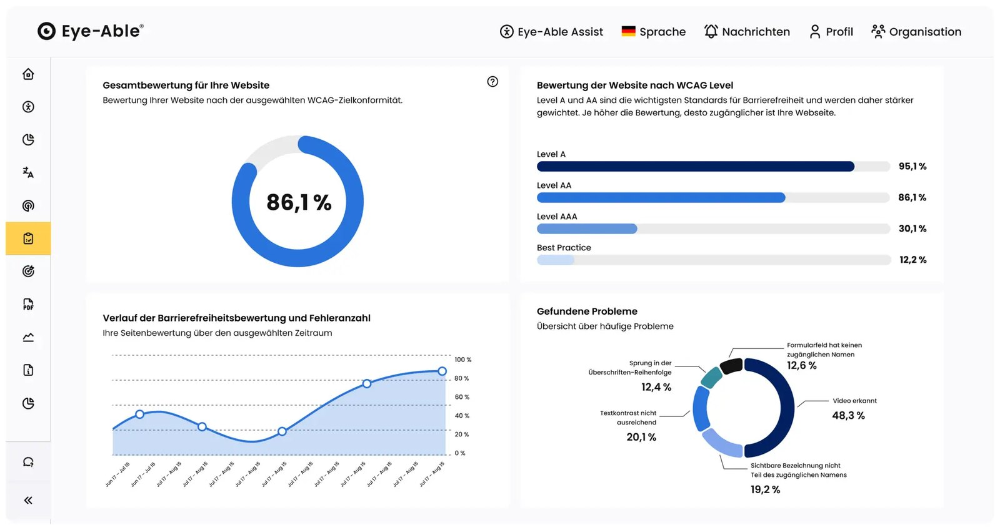
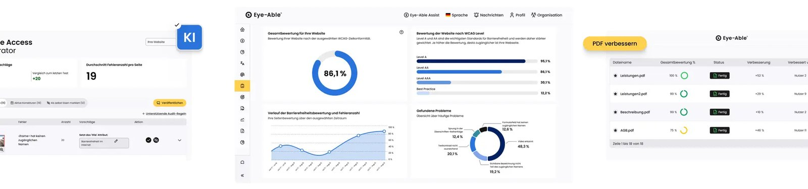
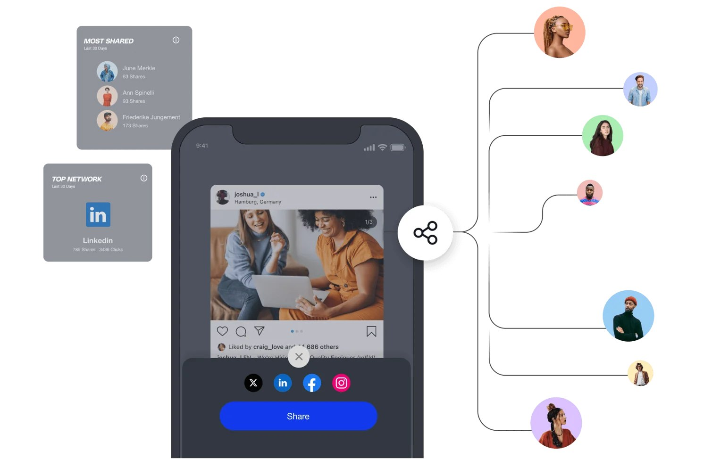
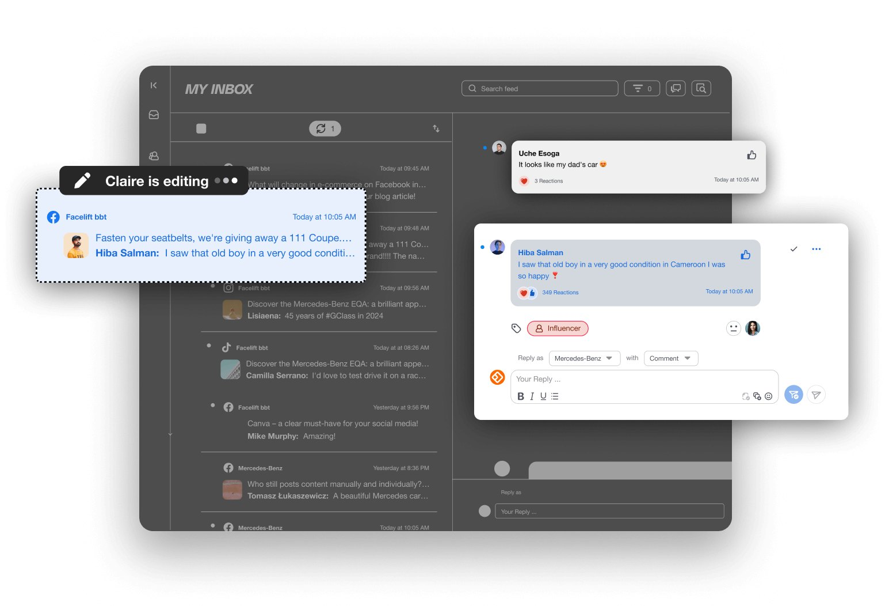
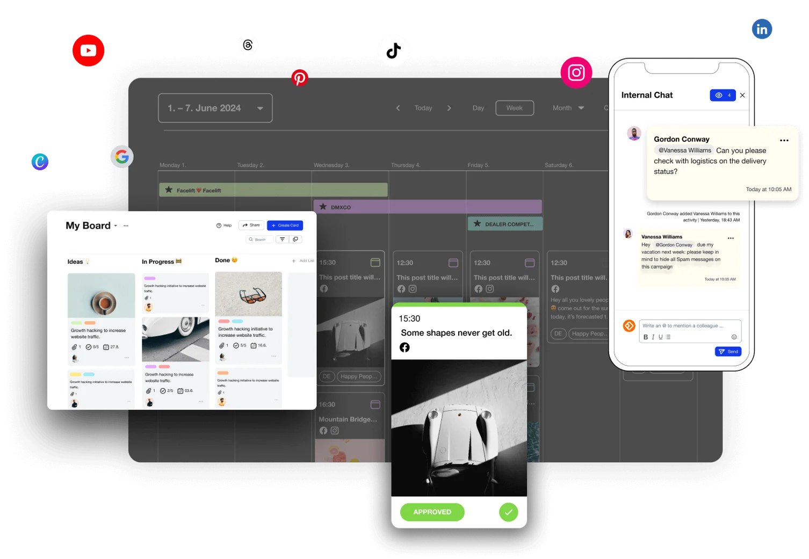
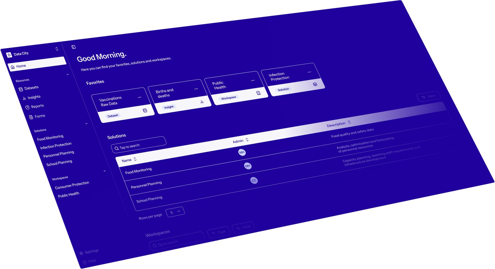

# Produktbild-Kandidaten — interner Review

> Technische Recherche, keine Veröffentlichungsfreigabe. Nur Bilder mit
> einer expliziten redaktionellen Entscheidung dürfen später nach
> `public/brand/screenshots/<slug>/shot-N.jpg` übernommen werden.

- Tools geprüft: 5
- Tools mit Kandidaten: 4
- heruntergeladene Kandidaten: 8

## Eye-Able (Web Inclusion GmbH)

### Kandidat 1 — Score 32

- Bildquelle: https://a2.storyblok.com/f/259811/2156x1144/37879bf91c/dashboard_en.png/m/1920x0/filters:quality(70):no_upscale()
- Fundstelle: https://eye-able.com
- Format: 1920 × 1019 px · webp
- Gründe: +12:dashboard, +6:grosse-quelldatei, +8:hohe-aufloesung, +6:produktbild-format
- Review: `needs_review` — zeigt das Bild wirklich die Software-Oberfläche?

### Kandidat 2 — Score 0

- Bildquelle: https://a2.storyblok.com/f/259811/3840x900/54314204ae/hero-image-de.png/m/1920x0/filters:quality(70):no_upscale()
- Fundstelle: https://eye-able.com
- Format: 1920 × 450 px · webp
- Gründe: -3:hero, +6:grosse-quelldatei, +5:brauchbare-aufloesung, -8:ungeeignetes-format
- Review: `needs_review` — zeigt das Bild wirklich die Software-Oberfläche?

## Facelift Cloud GmbH

### Kandidat 1 — Score 19

- Bildquelle: https://facelift-bbt.com/hs-fs/hubfs/Product_Amplify.png?width=1492&height=1085&name=Product_Amplify.png
- Fundstelle: https://facelift-bbt.com
- Format: 1492 × 974 px · webp
- Gründe: +5:product, +8:hohe-aufloesung, +6:produktbild-format
- Review: `needs_review` — zeigt das Bild wirklich die Software-Oberfläche?

### Kandidat 2 — Score 19

- Bildquelle: https://facelift-bbt.com/hs-fs/hubfs/Product_Analyze.png?width=1494&height=1094&name=Product_Analyze.png
- Fundstelle: https://facelift-bbt.com
- Format: 1494 × 1094 px · webp
- Gründe: +5:product, +8:hohe-aufloesung, +6:produktbild-format
- Review: `needs_review` — zeigt das Bild wirklich die Software-Oberfläche?

### Kandidat 3 — Score 19

- Bildquelle: https://facelift-bbt.com/hs-fs/hubfs/Product_Engage.png?width=1538&height=1052&name=Product_Engage.png
- Fundstelle: https://facelift-bbt.com
- Format: 1538 × 1052 px · webp
- Gründe: +5:product, +8:hohe-aufloesung, +6:produktbild-format
- Review: `needs_review` — zeigt das Bild wirklich die Software-Oberfläche?

### Kandidat 4 — Score 19

- Bildquelle: https://facelift-bbt.com/hs-fs/hubfs/Product_Orchestrate.png?width=1506&height=1064&name=Product_Orchestrate.png
- Fundstelle: https://facelift-bbt.com
- Format: 1506 × 1041 px · webp
- Gründe: +5:product, +8:hohe-aufloesung, +6:produktbild-format
- Review: `needs_review` — zeigt das Bild wirklich die Software-Oberfläche?

## Parloa GmbH

### Kandidat 1 — Score 20

- Bildquelle: https://a.storyblok.com/f/330303/1940x860/1ec2cf42fa/tui.png/m/1400x0/filters:quality(undefined):format(webp)
- Fundstelle: https://parloa.com
- Format: 1400 × 621 px · webp
- Gründe: +6:grosse-quelldatei, +8:hohe-aufloesung, +6:produktbild-format
- Review: `needs_review` — zeigt das Bild wirklich die Software-Oberfläche?

## Nextcloud GmbH

Keine ausreichend großen Bildkandidaten gefunden.

## Polyteia GmbH

### Kandidat 1 — Score 14

- Bildquelle: https://cdn.prod.website-files.com/64f07393c02984e046baf5f8/67f672bbaea8313ff17c42c8_EN%20UI-Home.avif
- Fundstelle: https://polyteia.com
- Format: 2788 × 1517 px · avif
- Gründe: +8:hohe-aufloesung, +6:produktbild-format
- Review: `needs_review` — zeigt das Bild wirklich die Software-Oberfläche?
